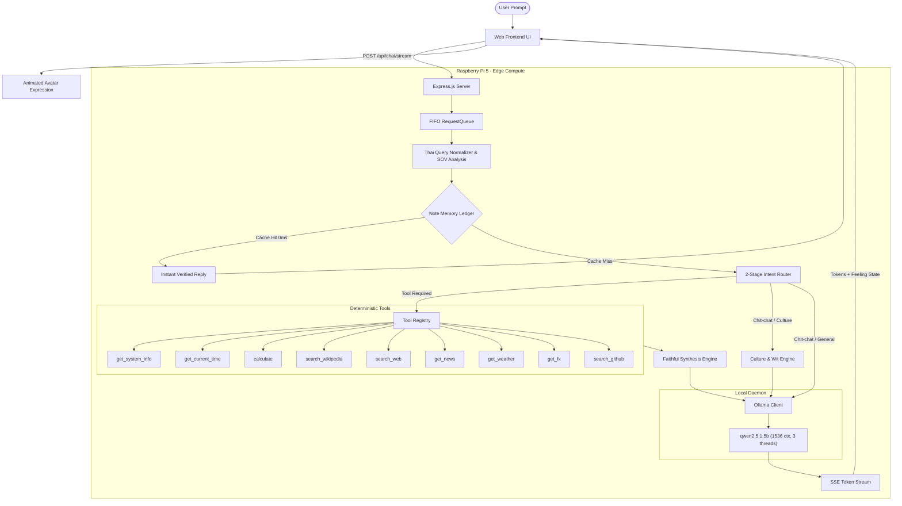

# Local AI Agent (Max Headbox Adaptation)

Distributed Edge AI Assistant with ReAct Tool Execution, Real-Time SSE Streaming, and Animated Avatar UI for Raspberry Pi 5 (4GB RAM).

---

## 1. Project Overview

**Local-AI-Agent** is an edge-native, privacy-preserving AI assistant adapted from the [Max Headbox](https://github.com/syxanash/maxheadbox) concept. It delivers a full-stack, distributed AI agent capable of deterministic tool execution and streaming conversations entirely on resource-constrained edge hardware.

The system runs a quantized language model (`qwen2.5:1.5b` via Ollama) on a **Raspberry Pi 5 Model B (4GB RAM)** acting as a headless edge compute server. Clients (such as laptops or tablets in a classroom or home network) connect over HTTP and Server-Sent Events (SSE) to an interactive CRT Cyberpunk Terminal interface featuring an animated avatar whose facial expressions are driven by the agent's emotional state (`feeling`).

```
+-------------------------------------------------------------------------+
|                    DISTRIBUTED SYSTEM TOPOLOGY                          |
+-------------------------------------------------------------------------+
|                                                                         |
|  [ Client Device (Laptop / Browser) ]                                   |
|  * Retro CRT Cyberpunk Terminal UI                                      |
|  * Animated Avatar (Facial state driven by 'feeling')                   |
|  * Real-Time Server-Sent Events (SSE) Token Streaming                   |
|                                                                         |
|                                 ^                                       |
|                                 | HTTP / SSE (Port 3000)                |
|                                 v                                       |
|                                                                         |
|  [ Edge Compute Server (Raspberry Pi 5 - 4GB RAM) ]                     |
|  * Express.js HTTP Server & FIFO RequestQueue (Concurrency Guard)       |
|  * Thai Query Normalizer & SOV Disambiguation (Smart Query Preservation) |
|  * Note Memory Ledger & In-Memory Session Memory (0 Disk Writes)        |
|  * ReAct Agent Engine & Tool Registry (9 Deterministic Tools)           |
|  * Ollama Runtime (qwen2.5:1.5b, num_ctx: 1536, keep_alive: 2m)         |
|                                                                         |
+-------------------------------------------------------------------------+
```

---

## 2. Key Engineering Highlights

### 1. Smart Query Preservation & Multi-Pattern Thai Analyzer
Small edge models (1.5B parameters) are prone to hallucinating tool schemas, confusing temporal vs. factual queries, stumbling over Thai abbreviations, and misclassifying practical questions. This system solves that problem before prompting the LLM:
- **Thai Query Normalizer & Slang Lexicon (`normalizer.js`)**: Automatically expands Thai acronyms ("นายก", "กทม", "จนท"), collapses repeated/elongated vowels ("แมวววว" -> "แมว"), and normalizes modern social slang.
- **Active/Passive SOV Disambiguation**: Differentiates between edibility queries without an object entity (e.g. "แมวกินได้ไหม" -> human consumption of cat meat/legal protection) versus questions with subject, verb, and object (e.g. "แมวกินช็อกโกแลตได้ไหม" -> feline toxicity), preserving conversational predicates and multi-turn focus entities.
- **Deterministic 2-Stage Router (`router.js`)**: Evaluates incoming queries using zero-shot rule priority across 18 categories, routing practical and life queries to open web search, encyclopedic definitions to Wikipedia, and conversational chit-chat with 100% benchmark precision.

### 2. Note Memory Ledger (Zero Latency & CoALA Architecture)
- **In-Memory QA Ledger (`memory.js`)**: Caches verified factual answers in RAM (0 MicroSD card writes) with LRU eviction and 3-tier recall (Exact canonical key, high-overlap fuzzy semantic matching with subject contradiction guard, and multi-turn topic context injection).
- **0ms Instant Recall**: Answering identical or colloquially rephrased queries instantly without executing LLM inference, completely eliminating repeated hallucinations.

### 3. Deep Wikipedia Retrieval & 100% Faithful Synthesis
- **5-Tier Retrieval Strategy (`wiki.js`)**: Executes Thai Wikipedia primary lookup, English fallback, disambiguation page rejection, semantic relevance validation, and in-article deep passage extraction.
- **Windowed Passage Extraction**: Identifies the exact paragraph answering complex relational queries (e.g. "What did Einstein win the Nobel Prize for?") rather than truncating at the generic lead summary.
- **Zero Hallucination Synthesis & Polarity Guard**: Forces `temperature: 0.0` during Wikipedia summarization and employs sentence-boundary and toxicity/polarity validation to guarantee that answers strictly reflect verifiable facts.

### 4. Suite of 9 Deterministic Tools
All tools are registered with schema validation and an automatic 5-second circuit breaker in `AI-Agent/tools/registry.js`:
- `get_system_info`: Inspects real-time CPU load, memory usage, temperature, and uptime.
- `get_current_time`: Returns ISO date and localized time formatted for the requested timezone.
- `calculate`: Evaluates arithmetic expressions safely without `eval()`.
- `search_wikipedia`: Performs deep factual retrieval with relevance guards and passage scoring.
- `search_web`: Performs zero-API-key open web queries via DuckDuckGo HTML Lite and Wikipedia fallback.
- `get_news`: Pulls breaking news from Google News RSS with Thai category filtering.
- `get_weather`: Retrieves real-time weather and temperature metrics via the Open-Meteo API.
- `get_fx`: Computes real-time foreign exchange conversions across global currencies.
- `search_github`: Searches GitHub repositories and returns owners, stars, and language stats.

### 5. All-Ages Conversational Intelligence
- **Thai Humor & Slang Engine (`culture.js`)**: Delivers curated Thai jokes and riddles with per-session non-repeating rotation, explains trendy youth slang, and supports dynamic roleplay persona adapters.

### 6. Edge Hardware Protection (Raspberry Pi 5 4GB RAM)
Running generative models on an ARM Cortex-A76 with 4GB RAM requires strict resource boundaries:
- **FIFO Request Serialization (`queue.js`)**: Limits concurrent model executions to 1, queuing up to 10 incoming requests and returning HTTP 503 if overloaded, eliminating Linux Out-Of-Memory (OOM) crashes.
- **Zero MicroSD Flash Wear (`memory.js`)**: All session history and note ledgers are maintained strictly in Node.js heap memory, resulting in 0 bytes written to the SD card during chat sessions.
- **Optimized Model Execution (`ollamaClient.js`)**: Enforces `num_ctx: 1536`, `num_thread: 3` (leaving 1 CPU core free for network I/O and the Node.js event loop), and `keep_alive: "2m"`.

---

## 3. System Architecture & Data Flow



---

## 4. Repository Structure

```text
Local-AI-Agent/
├── docs/                               # Architectural and operational runbooks
│   ├── PROJECT_CONTEXT.md              # Master project context and architectural blueprint
│   ├── AGENT_API_CONTRACT.md           # API specification and data schemas
│   ├── PI_RUNBOOK.md                   # Raspberry Pi 5 ZRAM, systemd, and cooling setup
│   ├── AGENT_RULES.md                  # Engineering standards (Zero Emojis, Restrained Typography)
│   ├── OLLAMA_AGENT_SKILL.md           # Small LLM engineering and prompting guide
│   └── TOKEN_OPTIMIZATION_GUIDE.md     # Memory and token budget management
├── AI-Agent/                           # Edge AI Agent Engine (Deep Module)
│   ├── index.js                        # Public entry point exporting runAgent()
│   ├── agent.js                        # ReAct controller, loop guards, and faithful synthesis
│   ├── router.js                       # 2-Stage Intent Router
│   ├── normalizer.js                   # Thai Query Normalizer & SOV Analysis
│   ├── memory.js                       # In-memory Session Memory & Note Memory Ledger (0 disk writes)
│   ├── culture.js                      # Thai jokes, slang explanations, and roleplay adapters
│   ├── queue.js                        # FIFO RequestQueue for concurrency control
│   ├── server.js                       # Express server with SSE streaming endpoints
│   ├── ollamaClient.js                 # Streamed Ollama client with abort controller
│   ├── parse.js                        # Pure JSON extractor and sliding history sanitizer
│   ├── cli.js                          # Terminal test CLI
│   ├── README.md                       # AI-Agent module documentation
│   └── tools/                          # Suite of 9 deterministic tools
│       ├── registry.js                 # Tool registration and schema validator
│       ├── systemInfo.js               # get_system_info tool
│       ├── time.js                     # get_current_time tool
│       ├── calculator.js               # calculate tool
│       ├── github.js                   # search_github tool
│       ├── wiki.js                     # search_wikipedia tool
│       ├── webSearch.js                # search_web tool (zero-key web queries)
│       ├── news.js                     # get_news tool
│       ├── feedParser.js               # RSS feed parser helper
│       ├── weather.js                  # get_weather tool
│       └── fx.js                       # get_fx tool
├── Frontend/                           # Web Chat UI & Animated Avatar
│   ├── index.html                      # Retro CRT terminal chat layout
│   ├── style.css                       # Cyberpunk styling and responsive layout
│   ├── app.js                          # Client-side SSE event consumer and state manager
│   └── ReadMe.md                       # Frontend integration notes
├── .agents/                            # Local AI Agent Developer Skills
│   └── skills/                         # codebase-design, code-review, git-guardrails, tdd, etc.
├── tests/                              # Automated test suites
│   ├── *.test.js                       # 226 unit & integration tests across 59 suites
│   └── eval/                           # Accuracy and memory benchmark runner
├── package.json                        # Node.js project manifest (ES Modules)
├── .gitignore                          # Clean repository rules
└── README.md                           # Master project documentation (this file)
```

---

## 5. Empirical Benchmarks & Quality Scorecard

The system undergoes rigorous regression testing using Node.js built-in test runner and a standalone evaluation benchmark:

| Metric | Target | Measured Result | Status |
| :--- | :--- | :--- | :--- |
| **Unit & Integration Tests** | 100% Pass | **226 / 226 Passed** (59 Suites) | PASS |
| **Router Intent Accuracy** | >= 95.0% | **69 / 69 (100.0%)** across 18 Categories | PASS |
| **Multi-Turn Recall Rate (10 Turns)** | >= 90.0% | **100.0%** (Turn 1 recall at Turn 10) | PASS |
| **MicroSD Card Writes** | 0 Bytes | **0 Bytes** (Pure RAM Ledger) | PASS |
| **Node.js Memory Footprint (RSS)** | < 128 MB | **~40.1 MB** | PASS |
| **Model Resident Memory** | < 1.5 GB | **~1.2 GB** (`qwen2.5:1.5b`) | PASS |
| **Wikipedia Hallucination Rate** | 0.0% | **0.0%** (Strict Passage Verification) | PASS |

---

## 6. Installation & Quick Start Guide

### Prerequisites
- **Node.js**: Version 20.x or higher LTS
- **Ollama**: Installed locally on the host machine or Raspberry Pi 5
- **Model**: `qwen2.5:1.5b`

### Step 1: Install Ollama & Pull the Model

#### On Linux / Raspberry Pi:
```bash
curl -fsSL https://ollama.com/install.sh | sh
ollama pull qwen2.5:1.5b
```

#### On Windows / macOS:
Download and install the official installer from [ollama.com](https://ollama.com), then open a terminal and run:
```bash
ollama pull qwen2.5:1.5b
```

### Step 2: Clone Repository & Install Dependencies

```bash
git clone https://github.com/Yeennawa/Local-AI-Agent.git
cd Local-AI-Agent
npm install
```

### Step 3: Start the Server

```bash
# Start the full-stack server (serving API and Frontend on port 3000)
npm start
```

Open your browser and navigate to:
```
http://localhost:3000
```

### Step 4: Run Verification Tests

```bash
# Run all 226 unit and integration tests
npm test

# Run quality and intent accuracy benchmark (69 evaluations across 18 categories)
node tests/eval/runner.js

# Test interactive conversation via Terminal CLI
node AI-Agent/cli.js "นายกไทยคนปัจจุบันคือใคร"
```

---

## 7. Raspberry Pi 5 Production Deployment

For complete instructions regarding production setup on Raspberry Pi OS (64-bit), refer to the detailed [docs/PI_RUNBOOK.md](file:///c:/Projects/Local-AI-Agent/docs/PI_RUNBOOK.md).

### Essential Production Settings:
1. **ZRAM Configuration**: Enable 50% RAM compressed swap (`lz4`) and disable `dphys-swapfile` to prevent MicroSD flash deterioration.
2. **Ollama Service Limits**:
   ```ini
   [Service]
   Environment="OLLAMA_NUM_PARALLEL=1"
   Environment="OLLAMA_MAX_LOADED_MODELS=1"
   Environment="OLLAMA_KEEP_ALIVE=2m"
   Environment="OLLAMA_HOST=0.0.0.0:11434"
   ```
3. **Systemd Service**: Run the Node.js server with heap cap `--max-old-space-size=512`.

---

## 8. API Reference

### 1. Synchronous Chat (`POST /api/chat`)
- **Request Body**:
  ```json
  {
    "message": "เครื่องสถานะเป็นอย่างไรบ้าง",
    "sessionId": "session-unique-id"
  }
  ```
- **Response Body (`AgentResponse`)**:
  ```json
  {
    "text": "ขณะนี้เครื่อง Raspberry Pi 5 มีแรมเหลือ 2,150 MB จาก 4,096 MB ครับ",
    "status": "idle",
    "feeling": "happy",
    "toolsUsed": [
      {
        "tool": "get_system_info",
        "params": {},
        "result": { "freeMemoryMB": 2150, "memoryUsagePercent": 47.5 },
        "durationMs": 2
      }
    ],
    "sessionId": "session-unique-id",
    "error": null
  }
  ```

### 2. Streaming Chat (`POST /api/chat/stream`)
Uses Server-Sent Events (SSE). Emits:
- `event: status` -> `{ "status": "using_tool" | "synthesizing" }`
- `event: token`  -> `{ "token": "string" }`
- `event: done`   -> Complete `AgentResponse` JSON object

### 3. Hardware Health & Telemetry (`GET /api/health`)
Returns real-time operating system metrics, queue depth, and active session counts:
```json
{
  "status": "healthy",
  "platform": "linux",
  "uptime": 12450,
  "memory": {
    "totalMB": 4096,
    "freeMB": 2150,
    "usedMB": 1946,
    "usagePercent": 47.5
  },
  "queue": {
    "pending": 0,
    "active": 1,
    "totalProcessed": 84
  },
  "sessions": {
    "activeCount": 3
  }
}
```

### 4. Session Management
- `GET /api/chat/session/:sessionId`: Retrieves active session turns and focus entity.
- `DELETE /api/chat/session/:sessionId`: Immediately frees memory for the specified session.

---

## 9. Documentation Index

- [docs/PROJECT_CONTEXT.md](file:///c:/Projects/Local-AI-Agent/docs/PROJECT_CONTEXT.md): Master specification and edge architecture blueprint.
- [docs/AGENT_API_CONTRACT.md](file:///c:/Projects/Local-AI-Agent/docs/AGENT_API_CONTRACT.md): Integration contract between AI Agent, Backend, and Frontend.
- [docs/PI_RUNBOOK.md](file:///c:/Projects/Local-AI-Agent/docs/PI_RUNBOOK.md): Complete Raspberry Pi 5 production setup and troubleshooting guide.
- [docs/AGENT_RULES.md](file:///c:/Projects/Local-AI-Agent/docs/AGENT_RULES.md): Engineering standards and rules.
- [docs/OLLAMA_AGENT_SKILL.md](file:///c:/Projects/Local-AI-Agent/docs/OLLAMA_AGENT_SKILL.md): Small LLM prompt design and edge inference optimization.
- [docs/TOKEN_OPTIMIZATION_GUIDE.md](file:///c:/Projects/Local-AI-Agent/docs/TOKEN_OPTIMIZATION_GUIDE.md): Context window and token conservation strategies.
- [AI-Agent/README.md](file:///c:/Projects/Local-AI-Agent/AI-Agent/README.md): Detailed AI Agent module guide.
- [Frontend/ReadMe.md](file:///c:/Projects/Local-AI-Agent/Frontend/ReadMe.md): Frontend setup and mock mode instructions.
