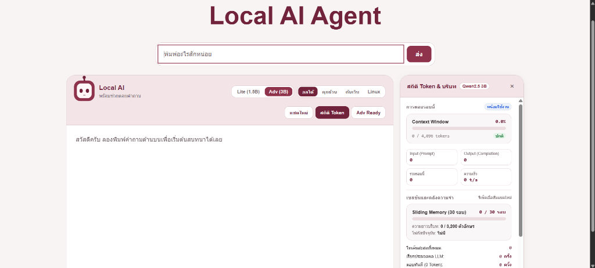

# Local AI Agent (Raspberry Pi 5 Edge AI Assistant)

ระบบผู้ช่วย AI อัจฉริยะประมวลผลบนอุปกรณ์เอดจ์ (Edge AI Assistant) แบบกระจายศูนย์ ออกแบบเฉพาะสำหรับบอร์ด **Raspberry Pi 5 (RAM 4GB)** และคอมพิวเตอร์ทั่วไป ขับเคลื่อนด้วย Ollama ในเครื่อง ทำงานอิสระ 100% ภายในเครือข่าย ปลอดภัย ไม่เสียค่าบริการ Cloud API และถนอม Flash Memory ด้วยการไม่เขียนไฟล์ชั่วคราวลง MicroSD Card (Zero Disk Writes)



---

## 1. จุดเด่นทางวิศวกรรม (Engineering Highlights)

- **100% Local Inference:** ประมวลผลโมเดลภาษา Qwen 2.5 (1.5B Lite / 3B Advanced) ผ่าน Ollama บนบอร์ด Raspberry Pi 5 ไม่ส่งข้อมูลออกนอกเครื่อง
- **Adaptive RAG 4 Tiers:** คัดกรองคำถามด้วย Intent Router แม่นยำ 100% โดยไม่เสีย Token ในรอบตัดสินใจ แยกตอบทันทีด้วยข้อมูลในตัว (0ms / 0 Token), เรียกเครื่องมือโครงสร้าง, หรือค้นเว็บเมื่อจำเป็น
- **Linux FIFO Runqueue v2:** ระบบคิวคำขอตามหลัก OS Scheduler (`SCHED_FIFO`) พร้อมคำนวณเวลารอคอยจริงตามสถิติ EWMA + P90 Tail Latency และแสดงตารางโพรเซสแบบ Real-time
- **Linux Assistant Mode & Command Guard:** โหมดผู้ช่วยคำสั่งระบบปฏิบัติการ Linux พร้อมคลังคำสั่ง 38 รายการ (Catalog-first, 0 Token) อธิบาย Flag ละเอียด มีปุ่มคัดลอก และปุ่มรันบนบอร์ด Pi สำหรับคำสั่งตรวจสอบที่ปลอดภัย (ป้องกัน `rm -rf`, Fork Bomb, Root Tampering ด้วย Command Guard)
- **4 Tool Modes:** ปรับเปลี่ยนพฤติกรรมของเครื่องมือได้ทันทีจากหน้าเว็บ (`ออโต้`, `คุยล้วน`, `ค้นเว็บ`, `Linux`) บันทึกสถานะลงใน LocalStorage
- **Dual Web Search Facade:** ค้นหาเว็บสองชั้นผ่าน `search_web` ดึงผลสรุปจาก Tavily AI เป็นหลัก และสลับไป DuckDuckGo HTML Lite (Zero-Key) อัตโนมัติเมื่อไม่มี API Key
- **30-Turn Verbatim Episodic Memory:** จดจำประวัติการสนทนาย้อนหลัง 30 รอบ (3,200 ตัวอักษร) พร้อมแถบสีเขียววัดความจุบริบทแบบ Real-time บนหน้าเว็บ
- **Linux Kernel Telemetry & Active Governor:** มอนิเตอร์ทรัพยากรฮาร์ดแวร์จริงจาก Linux Kernel (`/proc/meminfo`, ZRAM Compression, SoC Thermal, Rolling CPU) ทุก 2 วินาที พร้อมระบบตัดโหลดอัตโนมัติป้องกัน OOM Crash
- **Zero-CPU Animated Avatar:** ขับเคลื่อนตัวละครอวตารด้วย CSS Keyframes บน GPU เบราว์เซอร์ฝั่งไคลเอนต์ (ใช้ CPU บนบอร์ด Pi 5 เท่ากับ 0%) แสดง 6 สถานะและอารมณ์ตามบริบท
- **Production-Grade Test Suite:** ผ่านการทดสอบ Unit & Integration ครบทุกฟังก์ชันรวม **368 tests (77 suites ผ่าน 100%)**

---

## 2. เริ่มต้นใช้งานอย่างรวดเร็ว (Quick Start)

### ขั้นตอนที่ 1: ติดตั้ง Ollama และดาวน์โหลดโมเดล

```bash
# สำหรับ Linux / Raspberry Pi:
curl -fsSL https://ollama.com/install.sh | sh

# ดึงโมเดลสำหรับ Lite Mode (1.5B, ขนาด ~986 MB):
ollama pull qwen2.5:1.5b

# ดึงโมเดลสำหรับ Advanced Mode (3B, ขนาด ~1.9 GB - ทางเลือก):
ollama pull qwen2.5:3b
```

### ขั้นตอนที่ 2: ติดตั้งและตั้งค่าโปรเจกต์

```bash
# Clone คลังโค้ด
git clone https://github.com/Yeennawa/Local-AI-Agent.git
cd Local-AI-Agent

# ติดตั้ง Dependencies (ต้องการ Node.js 20+ LTS)
npm install

# กำหนดค่าสภาพแวดล้อม (ทางเลือก):
cp .env.example .env
# หากต้องการใช้ Tavily AI Search ให้ระบุ: TAVILY_API_KEY=tvly-xxxxxxxxxxxx
# หากไม่ระบุ ระบบจะใช้ DuckDuckGo HTML Lite (Zero-Key) โดยอัตโนมัติ
```

### ขั้นตอนที่ 3: เปิดใช้งานระบบ

```bash
# เริ่มต้นเซิร์ฟเวอร์แบบ Full-stack (ให้บริการ API และหน้าเว็บที่ Port 3000)
npm start
```

เปิดเว็บเบราว์เซอร์ไปที่: `http://localhost:3000` (หรือ `http://<IP_ของ_Raspberry_Pi>:3000`)

---

## 3. แผนผังสถาปัตยกรรมระบบแบบ Interactive (Archify Diagrams & Slide Export)

เพื่อความคมชัดสูงสุดในการนำไปใช้ทำสไลด์นำเสนอหรือรายงาน สามารถเปิดไฟล์ Interactive HTML ด้านล่างบนเว็บเบราว์เซอร์เพื่อซูมดูรายละเอียด สลับธีมมืด/สว่าง และกดปุ่ม **Export SVG / Export PNG** มุมขวาบนเพื่อบันทึกเป็นรูปภาพความละเอียดสูงได้ทันที:

| แผนผังสถาปัตยกรรม | ลิงก์เปิดหน้า Interactive HTML (รองรับ Export รูปภาพ) | ขอบเขตเนื้อหาในแผนผัง |
| :--- | :--- | :--- |
| **1. ภาพรวมทั้งระบบ (System Architecture)** | **[เปิดแผนผัง System Architecture (HTML)](docs/architecture/system-architecture.html)** | แสดงการทำงานร่วมกันทั้ง 3 ระดับ: Client Browser, Express & Linux Runqueue v2, AI Agent Core และ Ollama บน Raspberry Pi 5 |
| **2. แกนประมวลผล AI (AI-Agent Pipeline)** | **[เปิดแผนผัง AI-Agent Pipeline (HTML)](docs/architecture/ai-agent-pipeline.html)** | แสดงขั้นตอนภายใน [`AI-Agent/`](AI-Agent/README.md): Fast Recall, Thai Normalizer, Router & 4 Tool Modes, 10 Tools, Linux Command Guard และ 2-Pass Reflection |
| **3. ส่วนติดต่อผู้ใช้ (Frontend Architecture)** | **[เปิดแผนผัง Frontend Architecture (HTML)](docs/architecture/frontend-architecture.html)** | แสดงสถาปัตยกรรมภายใน [`Frontend/`](Frontend/ReadMe.md): การรับส่ง SSE Events, Queue Modal, Thinking Trail, Linux Card, Zero-CPU Avatar และ Telemetry Drawer |

---

## 4. โหมดการทำงานของเครื่องมือ (Tool Modes)

| โหมด | สัญลักษณ์บนหน้าเว็บ | พฤติกรรมของระบบ |
| :--- | :--- | :--- |
| **ออโต้ (Auto)** | `ออโต้` | โหมด Adaptive RAG เต็มรูปแบบ เลือกระหว่างตอบทันที, ใช้เครื่องมือเฉพาะทาง, หรือค้นหาเว็บตามเจตนาคำถาม |
| **คุยล้วน (Chat)** | `คุยล้วน` | ปิดการค้นหาเว็บภายนอกทั้งหมด ตอบด้วย Parametric Knowledge ทันทีเพื่อความรวดเร็วและประหยัด Token (ยังใช้เครื่องมือภายในเครื่อง เช่น เวลา, คำนวณ, ข้อมูลเครื่อง) |
| **ค้นเว็บ (Search)** | `ค้นเว็บ` | บังคับสืบค้นข้อมูลเว็บเปิดสดใหม่ผ่าน Tavily หรือ DuckDuckGo สำหรับทุกคำถามที่เป็นความรู้ทั่วไป |
| **ผู้ช่วย Linux (Linux)** | `Linux` | เจาะจงงานระบบ OS และ Raspberry Pi ดึงคำสั่งจาก Catalog 38 รายการ (0 Token) พร้อมระบบ Guard และปุ่มรันบนบอร์ด |

---

## 5. เครื่องมือในระบบทั้ง 10 ตัว (Deterministic Tool Suite)

ทุกเครื่องมือทำงานแบบ Deterministic ผ่านระบบตรวจสอบพารามิเตอร์และควบคุม Timeout ป้องกันการค้าง:

| ชื่อเครื่องมือ | หน้าที่การทำงาน | แหล่งข้อมูล | รูปแบบการตอบกลับ |
| :--- | :--- | :--- | :--- |
| `linux_assistant` | ผู้ช่วยคำสั่งระบบปฏิบัติการ Linux บน Raspberry Pi 5 | คลังคำสั่ง 38 รายการ + Fallback Guarded LLM | การ์ดคำสั่งและคำอธิบาย Flag (0 Token) |
| `get_system_info` | ตรวจสอบสถานะฮาร์ดแวร์ (RAM, CPU, อุณหภูมิ, Uptime) | Linux Kernel (/proc, /sys) & Node.js OS | โครงสร้างแม่แบบ (0 Token) |
| `get_current_time` | ตรวจสอบวันและเวลาปัจจุบันตามเขตเวลา | ระบบนาฬิกาเครื่อง (Intl DateTime) | โครงสร้างแม่แบบ (0 Token) |
| `calculate` | คำนวณทางคณิตศาสตร์อย่างปลอดภัย ปราศจาก `eval()` | Pure Function Tokenizer | โครงสร้างแม่แบบ (0 Token) |
| `get_weather` | ตรวจสอบสภาพอากาศ อุณหภูมิ และความชื้น Real-time | Open-Meteo API | โครงสร้างแม่แบบ (0 Token) |
| `get_fx` | ตรวจสอบและคำนวณอัตราแลกเปลี่ยนเงินตราสากล | Frankfurter Currency API | โครงสร้างแม่แบบ (0 Token) |
| `get_news` | ดึงพาดหัวข่าวเด่นล่าสุดตามหมวดหมู่ภาษาไทย | Google News RSS Feed | โครงสร้างแม่แบบ (0 Token) |
| `search_github` | ค้นหาคลังโค้ด ยอดดาว และภาษาโปรแกรมบน GitHub | GitHub REST API | โครงสร้างแม่แบบ (0 Token) |
| `search_wikipedia` | ค้นหาบทความเชิงลึก ข้ามหน้ากำกวม และเจาะจง Passage | Wikipedia API (TH/EN) | สังเคราะห์สรุปเนื้อหา (LLM) |
| `search_web` | สืบค้นข้อมูลเว็บเปิดแบบสดใหม่ (Tavily AI -> DuckDuckGo) | Tavily Search / DuckDuckGo Lite | สังเคราะห์สรุปเนื้อหา (LLM) |

---

## 6. โครงสร้างไฟล์ของโปรเจกต์ครบทุกไฟล์ (Complete Repository Structure)

```text
Local-AI-Agent/
├── docs/                               # เอกสารสถาปัตยกรรมและคู่มือการติดตั้ง
│   ├── assets/
│   │   └── web-ui-overview.png         # ภาพหน้าจอจริงของ Web Chat UI และ Telemetry Drawer
│   ├── architecture/                   # แผนผังสถาปัตยกรรม Interactive HTML (สร้างด้วย Archify)
│   │   ├── system-architecture.html    # แผนผังสถาปัตยกรรมภาพรวมทั้งระบบ (พร้อมปุ่ม Export SVG/PNG)
│   │   ├── ai-agent-pipeline.html      # แผนผังการทำงานภายในโมดูล AI-Agent
│   │   └── frontend-architecture.html  # แผนผังการทำงานและการไหลของ Event ฝั่ง Frontend
│   ├── PROJECT_CONTEXT.md              # พิมพ์เขียวสถาปัตยกรรมระบบฉบับสมบูรณ์
│   ├── AGENT_API_CONTRACT.md           # สัญญาข้อกำหนด API (Version 2.0.0)
│   ├── PI_RUNBOOK.md                   # คู่มือการติดตั้ง ZRAM และ Systemd บน Raspberry Pi 5
│   ├── AGENT_RULES.md                  # กฎระเบียบวิศวกรรม (Zero Emojis, Clean Seams)
│   ├── OLLAMA_AGENT_SKILL.md           # แนวทางการควบคุมโมเดลขนาดเล็ก (Sub-4B LLM)
│   └── TOKEN_OPTIMIZATION_GUIDE.md     # คู่มือการบริหารจัดการ Context Window และ Token
├── AI-Agent/                           # แกนประมวลผล AI Agent (Deep Module)
│   ├── index.js                        # จุดเชื่อมต่อหลัก ส่งออก runAgent() และ applyToolModePolicy()
│   ├── agent.js                        # ตัวควบคุมหลัก (Pipeline: Recall -> Resolve -> Route -> Synthesize)
│   ├── server.js                       # Express Server ให้บริการ REST API, SSE Streaming และ /api/linux/execute
│   ├── queue.js                        # Linux FIFO Runqueue v2 (SCHED_FIFO) พร้อมคำนวณเวลารอด้วย EWMA + P90
│   ├── ollamaClient.js                 # ตัวเชื่อมต่อ Ollama พร้อม Watchdog Heartbeat ป้องกันค้าง
│   ├── modelManager.js                 # ระบบสลับโมเดลแบบไดนามิก (1.5B / 3B) ปลอดภัยด้วย Sequential Unload
│   ├── osMonitor.js                    # ตัววัดสถานะเคอร์เนล Linux (/proc/meminfo, ZRAM, SoC Temp, Active Governor)
│   ├── telemetry.js                    # ระบบคำนวณ Token และรวบรวมสถิติ Real-time (0 Disk Writes)
│   ├── toolMode.js                     # ระบบควบคุมโหมดเครื่องมือทั้ง 4 โหมด (auto, chat, search, linux)
│   ├── router.js                       # ระบบคัดกรองเจตนา 100% Deterministic (23 หมวดหมู่)
│   ├── resolver.js                     # ระบบเชื่อมโยงคำถามต่อเนื่อง (Conversational Query Resolver)
│   ├── normalizer.js                   # ตัวแปลงคำย่อภาษาไทย, Slang, และโครงสร้างประโยค SOV
│   ├── memory.js                       # ระบบความจำเซสชัน 30 รอบ (3,200 ตัวอักษร) และ Note Memory Ledger ใน RAM
│   ├── answer.js                       # ระบบจัดรูปคำตอบโครงสร้าง (0 Token) และป้องกันประโยคขาดช่วง
│   ├── reflection.js                   # ระบบตรวจประเมินคุณภาพคำตอบสองชั้น (Two-Pass Self-Reflection)
│   ├── languageGuard.js                # ระบบตรวจจับภาษา สกัดกั้นอักษรภาษาอื่นปนเปื้อน (CJK Leakage Clean)
│   ├── safety.js                       # ระบบตรวจสอบความปลอดภัยและเตือนสารพิษ/สิ่งผิดกฎหมาย
│   ├── replies.js                      # ตัวสร้างคำตอบตรงสำหรับข้อมูลตัวตนและขีดความสามารถของระบบ
│   ├── culture.js                      # คลังมุกตลกไทย คำศัพท์วัยรุ่น และ Roleplay Persona Adapter
│   ├── parse.js                        # ตัวสกัด JSON ปลอดภัย และ Sliding History Sanitizer
│   ├── cli.js                          # สคริปต์สำหรับทดสอบสนทนากับ Agent ผ่าน Terminal
│   ├── README.md                       # คู่มือประจำโมดูล AI Agent
│   ├── linux/                          # โมดูลผู้ช่วยระบบปฏิบัติการ Linux (OS Lab Assistant)
│   │   ├── catalog.js                  # คลังคำสั่ง Linux 38 รายการ พร้อมคำอธิบาย Flag ภาษาไทย
│   │   ├── commandGuard.js             # ระบบตรวจสอบความปลอดภัยคำสั่งและรัน execFile แบบไร้เชลล์
│   │   └── linuxAssistant.js           # ตัวประมวลผลคำสั่งแบบ Catalog-First และ Fallback Guarded LLM
│   └── tools/                          # โฟลเดอร์เครื่องมือ Deterministic Tools ทั้ง 10 ตัว
│       ├── registry.js                 # ระบบลงทะเบียน ตรวจสอบพารามิเตอร์ และคุม Per-Tool Timeout
│       ├── linuxTool.js                # เครื่องมือ linux_assistant เชื่อมต่อระบบผู้ช่วย Linux
│       ├── systemInfo.js               # เครื่องมือ get_system_info อ่านค่าสถานะเครื่องและแรม
│       ├── time.js                     # เครื่องมือ get_current_time อ่านเวลาและวันที่ปัจจุบัน
│       ├── calculator.js               # เครื่องมือ calculate คำนวณคณิตศาสตร์ปลอดภัยไร้ eval()
│       ├── weather.js                  # เครื่องมือ get_weather พยากรณ์อากาศ Real-time (Open-Meteo)
│       ├── fx.js                       # เครื่องมือ get_fx อัตราแลกเปลี่ยนเงินตราสากล
│       ├── news.js                     # เครื่องมือ get_news ดึงพาดหัวข่าว Google News RSS
│       ├── feedParser.js               # ตัวแปลงโครงสร้าง XML/RSS Feed สำหรับระบบข่าว
│       ├── github.js                   # เครื่องมือ search_github ค้นหาคลังโค้ดบน GitHub
│       ├── wiki.js                     # เครื่องมือ search_wikipedia พร้อม Deep Passage Retrieval
│       ├── webSearch.js                # เครื่องมือ search_web แบบ Single Facade
│       └── search/                     # โมดูลผู้ให้บริการสืบค้นเว็บสองชั้น
│           ├── tavily.js               # ผู้ให้บริการ Tavily AI Search พร้อมระบบวินิจฉัย API Key
│           └── duckduckgo.js           # ผู้ให้บริการ DuckDuckGo HTML Lite แบบไม่ต้องใช้ API Key
├── Frontend/                           # ส่วนติดต่อผู้ใช้และแอนิเมชันอวตาร
│   ├── index.html                      # โครงสร้างหน้าเว็บ แผงควบคุม อวตาร และ Telemetry Drawer
│   ├── style.css                       # สไตล์ชีท Cyber-Minimalist และแอนิเมชัน CSS GPU Keyframes
│   ├── app.js                          # ตรรกะฝั่ง Client จัดการ SSE Streaming, Queue Modal, Linux Card และ Meters
│   └── ReadMe.md                       # คู่มือการทำงานและการเชื่อมต่อของ Frontend
├── .agents/skills/                     # ชุดทักษะวิศวกรรมสำหรับพัฒนาและตรวจสอบระบบ
├── tests/                              # ชุดทดสอบระบบอัตโนมัติ (368 tests, 77 suites ผ่าน 100%)
├── .env.example                        # ไฟล์ตัวอย่างการตั้งค่าตัวแปรสภาพแวดล้อม
├── package.json                        # Node.js Project Manifest (Pure ES Modules)
├── .gitignore                          # ระเบียบความสะอาดของคลังโค้ด
└── README.md                           # เอกสารฉบับนี้
```

---

## 7. ผลการทดสอบและประสิทธิภาพ (Verification & Benchmarks)

ระบบผ่านการทดสอบครอบคลุมทุกโมดูลด้วยชุดทดสอบมาตรฐานของ Node.js (`npm test`):

| ตัวชี้วัดการประเมิน | เกณฑ์เป้าหมาย | ผลลัพธ์ที่วัดได้จริง | สถานะ |
| :--- | :--- | :--- | :--- |
| **Unit & Integration Tests** | ผ่าน 100% | **368 ผ่าน / 0 ล้มเหลว** (77 suites) | ผ่าน |
| **Router Intent Accuracy** | >= 95.0% | **86 / 86 (100.0%)** ครอบคลุม 23 หมวดหมู่ | ผ่าน |
| **Multi-Turn Recall Rate (30 รอบ)** | >= 90.0% | **จดจำคำถามย้อนหลัง #1..#30 ได้สมบูรณ์ (100.0%)** | ผ่าน |
| **Tool Mode Policy Accuracy** | 100.0% | **ควบคุมการปิด/เปิดเครื่องมือถูกต้องทุกโหมด (100.0%)** | ผ่าน |
| **Linux Command Guard Integrity** | 100.0% | **บล็อกคำสั่งทำลายระบบ, Fork Bomb, และ Root Tampering ได้ 100%** | ผ่าน |
| **MicroSD Card Writes** | 0 Bytes | **0 Bytes** (บันทึกข้อมูลเซสชันใน RAM ทั้งหมด) | ผ่าน |
| **Node.js Memory Footprint (RSS)** | < 128 MB | **~42.5 MB** | ผ่าน |
| **Ollama Resident RAM (Lite)** | < 1.5 GB | **~1.15 GB** (`qwen2.5:1.5b`) | ผ่าน |
| **Ollama Resident RAM (Adv)** | < 2.5 GB | **~2.35 GB** (`qwen2.5:3b`) | ผ่าน |

---

## 8. สรุปจุดเชื่อมต่อ API (API Endpoints Reference)

| Method | Endpoint | หน้าที่และการทำงาน |
| :--- | :--- | :--- |
| `POST` | `/api/chat/stream` | ส่งคำถามและรับคำตอบแบบ Server-Sent Events (SSE) ทีละ Token พร้อมข้อมูลสถานะ Real-time |
| `POST` | `/api/chat` | ส่งคำถามและรับคำตอบ JSON แบบซิงโครนัสรอบเดียว |
| `POST` | `/api/linux/execute` | รันคำสั่ง Linux ที่ผ่านการตรวจสอบความปลอดภัยแล้วบนบอร์ด Raspberry Pi 5 |
| `GET` | `/api/queue/status` | ตรวจสอบสถานะคิว Linux Runqueue v2 (`SCHED_FIFO`, PID, สถานะงาน, เวลาที่คาดว่าจะต้องรอ) |
| `GET` | `/api/model/status` | ตรวจสอบโหมดโมเดลปัจจุบัน (`lite`/`advanced`) และสถานะแรม |
| `POST` | `/api/model/switch` | สลับโหมดโมเดล AI อย่างปลอดภัยด้วย Sequential Unload (คืน `409` หากมีงานกำลังรัน) |
| `GET` | `/api/tools/status` | ตรวจสอบโหมดเครื่องมือที่รองรับ และสถานะ Tavily API Key |
| `GET` | `/api/tools/diagnostics` | วินิจฉัยสถานะ Tavily API Key เชิงลึก (รองรับ `?probe=1` เพื่อทดสอบยิงจริงโดยซ่อน Key) |
| `GET` | `/api/os/metrics` | รายงานสถานะเคอร์เนล Linux (/proc/meminfo, ZRAM, SoC Thermal, CPU Load, Active Governor) |
| `GET` | `/api/chat/session/:id` | ดึงประวัติการสนทนา, Focus Entity, และสรุปสถิติ Token ของเซสชันนั้นๆ |
| `DELETE`| `/api/chat/session/:id` | ล้างประวัติการสนทนาและคืน RAM ทันที (เรียกใช้เมื่อกดปุ่มแชตใหม่) |
| `GET` | `/api/health` | ตรวจสอบสถานะสุขภาพของฮาร์ดแวร์ Raspberry Pi 5 และจำนวนงานในคิว |
