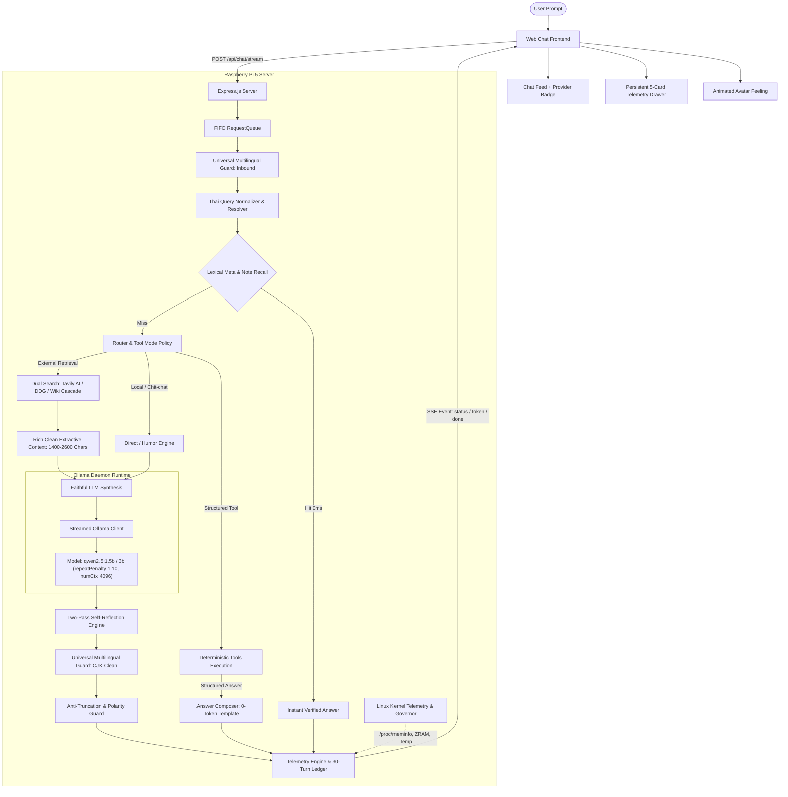

# Local AI Agent (Raspberry Pi 5 Edge AI Assistant)

ระบบผู้ช่วย AI อัจฉริยะประมวลผลในเครื่อง (Edge AI Assistant) แบบกระจายศูนย์ (Distributed Architecture) สำหรับบอร์ด **Raspberry Pi 5 (RAM 4GB)** และคอมพิวเตอร์ทั่วไป ขับเคลื่อนด้วยสถาปัตยกรรม **Adaptive RAG**, ระบบสลับโมเดลแบบไดนามิก (**Dynamic Model Switching**), โหมดควบคุมการทำงานของเครื่องมือ (**Tool Modes**), การสืบค้นเว็บแบบสองชั้น (**Dual Search Providers: Tavily AI & DuckDuckGo**), ระบบเฝ้าระวังเคอร์เนลและควบคุมแรงกดดันฮาร์ดแวร์ (**Linux Kernel Telemetry & Active OS Governor**), ระบบความจำอัตชีวประวัติ 30 รอบ (**30-Turn Verbatim Episodic Memory**), ระบบกลั่นกรองคำตอบสองชั้น (**Two-Pass Self-Reflection**), และระบบรักษาความบริสุทธิ์ของภาษา (**Universal Multilingual Guard**)

โปรเจกต์นี้ต่อยอดแนวคิดจาก [Max Headbox](https://github.com/syxanash/maxheadbox) โดยปรับปรุงสถาปัตยกรรมใหม่ทั้งหมดให้ทำงานเป็น **Deep Module** บนสภาพแวดล้อมฮาร์ดแวร์ทรัพยากรจำกัด ปราศจากการเรียกใช้งาน Cloud API ภายนอก (ยกเว้นบริการค้นหาเว็บทางเลือก) และปกป้อง Flash Memory ของ MicroSD Card ด้วยการไม่เขียนไฟล์ชั่วคราวลงดิสก์ (**Zero Disk Writes**)

---

## 1. จุดเด่นทางวิศวกรรม (Key Engineering Highlights)

| คุณสมบัติ | การทำงาน | กลไกเชิงวิศวกรรม (Engineering Mechanism) |
| :--- | :--- | :--- |
| **Dynamic Model Switching & Mutex** | สลับโหมด AI อย่างปลอดภัยระหว่าง Lite (1.5B) และ Advanced (3B) พร้อมระบบล็อกกันสลับขณะกำลังตอบ | **Sequential Unload + Busy Mutex (`409`)**: ปลดโมเดลเดิมออกจาก RAM (`keep_alive: 0`) และบล็อกการสลับกลางคันทั้งฝั่ง UI และ Server (`MODEL_BUSY_GENERATING`) พร้อม `createSafeTokenStream` กัน JSON ดิบหลุดขึ้นจอ |
| **Linux FIFO Runqueue v2** | ระบบคิวอิงวิชา OS Linux แสดงลำดับคิวและอุปกรณ์ที่กำลังใช้งานกลางหน้าจอแบบ Real-time | **`SCHED_FIFO` + PCB (`job_struct`)**: กำหนด PID, สถานะ `TASK_RUNNING` / `TASK_WAITING`, แจ้งลำดับคิวสดผ่าน SSE `event: queue` และถอนคิวอัตโนมัติทันทีเมื่อปิดแท็บหรือยกเลิก |
| **Tool Modes & Tavily Live Diagnostics** | โหมดเครื่องมือ 3 รูปแบบ พร้อมระบบวินิจฉัยปัญหา API Key ฝั่งเซิร์ฟเวอร์แบบละเอียดและโหลด `.env` อัตโนมัติ | **Hot-Reload `.env` + Live Probe**: ตรวจเช็ก `mtimeMs` ของไฟล์ `.env` โดยไม่ต้องรีสตาร์ต แยกสาเหตุ Error ครบทุกกรณี (`401`, `429/432`, Timeout, DNS) และมีปุ่มกดทดสอบสายตรงบน UI |
| **Dual Web Search & Closed-Book RAG** | ค้นหาข้อมูลเว็บเปิดสดใหม่และล็อกการอ้างอิงป้องกันอาการหลอนของโมเดลขนาดเล็ก | **Expanded Intent Router + Year Guard**: คัดกรองคำถามข้อมูลสดและข้อเท็จจริงเข้าเครื่องมือแม่นยำ แยก `GROUNDED_RAG_PROMPT` ห้ามแต่งตัวเลข/ปี พ.ศ. เอง พร้อมตรวจจับปีปลอมใน `reflection.js` |
| **Gemini-Style Live Thinking UI** | แสดงขั้นตอนการวิเคราะห์และเครื่องมือที่กำลังเรียกใช้แบบสดพร้อมนาฬิกาจับเวลาและพับเก็บได้ | **Full Lifecycle SSE Status**: ส่งสัญญาณครบทุกเฟส (`analyzing` -> `using_tool` -> `tool_done` -> `synthesizing` -> `reflecting`) ยุบเก็บเป็นปุ่มดูขั้นตอนย้อนหลังอัตโนมัติเมื่อเริ่มตอบ |
| **30-Turn Verbatim Episodic Memory** | จดจำคำถามและประวัติการสนทนาย้อนหลังได้ถึง 30 รอบ พร้อมหลอดสีเขียวแสดงผลแบบ Real-time | **Ordinal Question Recall & Live Meter**: บันทึกคำถามแบบ Verbatim ใน RAM ตอบคำถามย้อนหลังได้ 100% พร้อมขยับแถบสถานะสีเขียว/เหลือง/แดงทันทีตั้งแต่วินาทีที่ส่งคำถาม |
| **Universal Multilingual Guard** | ป้องกันการปนเปื้อนของภาษาต่างประเทศ (เช่น อักษรจีน CJK) ในคำตอบไทยและอังกฤษ | **Logit Tuning & Post-Generation Sanitizer**: ปรับจูน `repeat_penalty: 1.10`, `top_p: 0.85` พร้อม Stop Tokens ของ Qwen และฟังก์ชัน `cleanCJKLeakage` ลบเศษตัวอักษรหลุดรอด |
| **Two-Pass Self-Reflection** | กลั่นกรองคุณภาพและความถูกต้องของเนื้อหาก่อนส่งมอบให้ผู้ใช้ | **Lightweight Inspection & Year/Polarity Guard**: ตรวจจับการวนซ้ำ, ข้อความไม่สมบูรณ์, เนื้อหาขัดแย้ง, หรือการมั่วปี พ.ศ./ค.ศ. และปรับแก้เฉพาะจุดเมื่อจำเป็น |
| **Linux Kernel Telemetry & Live Polling** | เฝ้าระวังทรัพยากรฮาร์ดแวร์ Raspberry Pi 5 แบบสดต่อเนื่องทุก 2 วินาทีขณะประมวลผล | **Rolling Kernel Tick Sampler & Active Governor**: อ่าน `/proc/meminfo`, ZRAM Ratio, SoC Thermal, Rolling CPU% (`timer.unref()`) และมี Active Governor ป้องกัน OOM |
| **Persistent Telemetry UI (6 Cards)** | แสดงสถิติ Token, ความจำ, เคอร์เนล OS และสถานะ Tavily API แบบคงทนแม้รีเฟรชหน้าเว็บ | **Hydrated Tab State & Live Indicators**: จำค่าผ่าน `localStorage` ซิงก์กับเซสชันเบื้องหลัง อัปเดตสดระหว่างคิด และตรวจเช็กสถานะคีย์ค้นหาเว็บได้ทันที |
| **Pi 5 Endurance Timeouts** | ป้องกันการตัด Timeout กลางอากาศเมื่อโมเดล 3B ใช้เวลาคิดนานบน CPU ของ Raspberry Pi 5 | **Watchdog Heartbeat Architecture**: ขยาย Stall Timeout เป็น 5 นาที (เพดานรวม 10 นาที), ส่ง SSE `: ping` ทุก 10 วินาทีกัน Cloudflare Tunnel ตัดสาย และรีเซ็ต Client Watchdog อัตโนมัติ |
| **9 Deterministic Tools** | เครื่องมือดึงข้อมูลสดและคำนวณที่แม่นยำ 100% ปราศจากการเขียนดิสก์ | **Deterministic Tool Registry**: ระบบคัดกรองเจตนา 100% (Intent Router) ตัดสินใจเรียก Tool โดยไม่เสีย Token ในรอบวางแผน และไม่เขียน MicroSD Card (`0 Disk Writes`) |

---

## 2. เริ่มต้นใช้งานอย่างรวดเร็ว (Quick Start)

### ขั้นตอนที่ 1: ติดตั้ง Ollama และดาวน์โหลดโมเดล

```bash
# สำหรับ Linux / Raspberry Pi:
curl -fsSL https://ollama.com/install.sh | sh

# ดึงโมเดลสำหรับ Lite Mode (1.5B, ขนาด ~986 MB):
ollama pull qwen2.5:1.5b

# ดึงโมเดลสำหรับ Advanced Mode (3B, ขนาด ~1.9 GB - ทางเลือก):
ollama pull qwen2.5:3b
```
*(สำหรับ Windows หรือ macOS สามารถดาวน์โหลดตัวติดตั้งอย่างเป็นทางการได้จาก [ollama.com](https://ollama.com))*

### ขั้นตอนที่ 2: ติดตั้งและตั้งค่าโปรเจกต์

```bash
# Clone คลังโค้ด
git clone https://github.com/Yeennawa/Local-AI-Agent.git
cd Local-AI-Agent

# ติดตั้ง Node.js Dependencies (ต้องการ Node.js 20+ LTS)
npm install

# กำหนดค่า Environment Variables (ทางเลือก):
cp .env.example .env
# หากต้องการใช้ Tavily AI Search ให้ระบุ: TAVILY_API_KEY=tvly-xxxxxxxxxxxx
# หากไม่ระบุ ระบบจะใช้งาน DuckDuckGo HTML Lite (Zero-Key) โดยอัตโนมัติ
```

### ขั้นตอนที่ 3: เปิดใช้งานระบบ

```bash
# เริ่มต้นเซิร์ฟเวอร์แบบ Full-stack (ให้บริการทั้ง API และหน้าเว็บที่ Port 3000)
npm start
```

เปิดเว็บเบราว์เซอร์ไปที่: `http://localhost:3000` (หรือ `http://<IP_ของ_Raspberry_Pi>:3000`)

---

## 3. คู่มือการใช้งานหน้าเว็บและแผงควบคุม (Web UI Guide)

```text
+-----------------------------------------------------------------------------------------+
|                                    LOCAL AI AGENT UI                                    |
+-----------------------------------------------------------------------------------------+
|                                                                                         |
|  [ พิมพ์คำถามของคุณ...                                             ]  [ ส่ง ]           |
|                                                                                         |
|  +--------------------------------------------------+  +-----------------------------+  |
|  | (o_o)  Local AI                                  |  | สถิติ Token & บริบท [Qwen 1.5B] [X] |  |
|  |        [Lite 1.5B][Adv 3B]  [ออโต้][คุยล้วน][ค้นเว็บ] |  |-----------------------------|  |
|  |        [แชตใหม่] [สถิติ Token]  [Lite Ready]       |  | 1. ขีดจำกัดบริบท (Context)   |  |
|  |--------------------------------------------------|  | [====--------] 380/4,096 (9%)|  |
|  | [i] ใช้งาน Tavily AI Search สำเร็จแล้ว             |  |                             |  |
|  |--------------------------------------------------|  | 2. ความจำสไลด์ดิ้ง (Memory)  |  |
|  | User: อุณหภูมิกรุงเทพตอนนี้กี่องศา                    |  | รอบสนทนา: 2/30 รอบ          |  |
|  |                                                  |  | ขนาดบริบท: 450/3,200 อักษร  |  |
|  | Assistant: ขณะนี้กรุงเทพมหานครมีอุณหภูมิ 31.2°C ...  |  | โฟกัส: กรุงเทพมหานคร         |  |
|  | [ โมเดล: Qwen2.5 1.5B | ใช้เครื่องมือ: ค้นเว็บ (Tavily AI) ] |  |                             |  |
|  |                                                  |  | 3. ข้อมูลรอบล่าสุด (Last Turn) |  |
|  |                                                  |  | ประเภท: สังเคราะห์ LLM      |  |
|  |                                                  |  | Input: 290 | Output: 90     |  |
|  |                                                  |  | ความเร็ว: 41.9 t/s           |  |
|  |                                                  |  |                             |  |
|  |                                                  |  | 4. ยอดสะสมทั้งเซสชัน         |  |
|  |                                                  |  | ยอดรวม: 380 tokens (1 ครั้ง) |  |
|  |                                                  |  |                             |  |
|  |                                                  |  | 5. ระบบปฏิบัติการ (OS & Kernel)|  |
|  |                                                  |  | RAM ว่าง: 2,840 MB / 4,096 MB|  |
|  |                                                  |  | ZRAM: 142 MB (3.1x)         |  |
|  |                                                  |  | อุณหภูมิ SoC: 48.5 °C       |  |
|  |                                                  |  | CPU Load: 18.2% (3 AI / 1 OS)|  |
|  |                                                  |  | สถานะ Governor: ปกติ         |  |
|  +--------------------------------------------------+  +-----------------------------+  |
+-----------------------------------------------------------------------------------------+
```

### รายละเอียดปุ่มควบคุม:
1. **Model Switcher (`Lite (1.5B)` / `Adv (3B)`):**
   - **Lite Mode:** ใช้แรมเพียง ~1,150 MB เหมาะสำหรับการตอบทั่วไป รวดเร็ว และประหยัดพลังงาน
   - **Adv Mode:** ใช้แรม ~2,350 MB เหมาะสำหรับการวิเคราะห์เชิงลึก การเขียนโค้ด และการให้เหตุผลหลายชั้น
2. **Tool Mode Switcher (`ออโต้` / `คุยล้วน` / `ค้นเว็บ`):**
   - **ออโต้ (Auto):** โหมด Adaptive RAG อัจฉริยะ เลือกระหว่างข้อมูลในตัว, เครื่องมือ, หรือการค้นหาเว็บตามเจตนาคำถาม
   - **คุยล้วน (Chat):** ปิดการสืบค้นเว็บและ Wikipedia ทั้งหมด ตอบกลับด้วย Parametric Knowledge ทันทีเพื่อความรวดเร็วสูงสุด (ยังคงใช้เครื่องมือภายในเครื่อง เช่น เวลา, คำนวณ, สถานะเครื่อง)
   - **ค้นเว็บ (Search):** บังคับสืบค้นข้อมูลเว็บเปิดสดใหม่ผ่าน Tavily หรือ DuckDuckGo สำหรับทุกคำถามที่เป็นความรู้
3. **ปุ่ม `แชตใหม่` (New Chat):**
   - ล้างประวัติการสนทนาในหน้าต่างแชต คืนหน่วยความจำเซสชันบนเซิร์ฟเวอร์ และรีเซ็ตมาตรวัด Token กลับเป็น 0 ทันที
4. **ปุ่ม `สถิติ Token` (Telemetry Drawer):**
   - เปิด/ปิด แผงควบคุมด้านข้าง 5 การ์ดเพื่อตรวจสอบสถานะ Token และเคอร์เนลระบบแบบ Real-time โดยไม่บดบังพื้นที่แชต
5. **ป้ายกำกับความโปร่งใส (Metadata Badges):**
   - ใต้ข้อความตอบกลับของ AI จะระบุชื่อโมเดลที่ใช้ประมวลผลจริง และรายชื่อเครื่องมือรวมถึงผู้ให้บริการค้นหา (เช่น `ค้นเว็บ (Tavily AI)`) อย่างชัดเจน

---

## 4. สถาปัตยกรรมระบบและการไหลของข้อมูล (System Architecture)



---

## 5. เครื่องมือในระบบทั้ง 9 ตัว (Built-in Deterministic Tools)

ทุกเครื่องมือทำงานแบบ Deterministic ผ่านระบบตรวจสอบความถูกต้องของพารามิเตอร์และควบคุม Timeout ป้องกันการค้าง:

| ชื่อเครื่องมือ | คำอธิบายหน้าที่ | แหล่งข้อมูล | รูปแบบการตอบกลับ |
| :--- | :--- | :--- | :--- |
| `get_system_info` | ตรวจสอบสถานะฮาร์ดแวร์ (RAM, CPU, อุณหภูมิ, Uptime) | ระบบปฏิบัติการ (OS Monitor & Node.js API) | โครงสร้างแม่แบบ (0 Token) |
| `get_current_time` | ตรวจสอบวันและเวลาปัจจุบันตามเขตเวลา | ระบบนาฬิกาเครื่อง (Intl DateTime) | โครงสร้างแม่แบบ (0 Token) |
| `calculate` | คำนวณทางคณิตศาสตร์อย่างปลอดภัย ปราศจาก `eval()` | Pure Function Tokenizer | โครงสร้างแม่แบบ (0 Token) |
| `get_weather` | ตรวจสอบสภาพอากาศ อุณหภูมิ และความชื้นแบบ Real-time | Open-Meteo API | โครงสร้างแม่แบบ (0 Token) |
| `get_fx` | ตรวจสอบและคำนวณอัตราแลกเปลี่ยนเงินตราสากล | Frankfurter Currency API | โครงสร้างแม่แบบ (0 Token) |
| `get_news` | ดึงพาดหัวข่าวเด่นล่าสุดตามหมวดหมู่ภาษาไทย | Google News RSS Feed | โครงสร้างแม่แบบ (0 Token) |
| `search_github` | ค้นหาคลังโค้ด ยอดดาว และภาษาโปรแกรมบน GitHub | GitHub REST API | โครงสร้างแม่แบบ (0 Token) |
| `search_wikipedia` | ค้นหาบทความเชิงลึก ข้ามหน้ากำกวม และเจาะจง Passage | Wikipedia API (TH/EN) | สังเคราะห์สรุปเนื้อหา (LLM) |
| `search_web` | สืบค้นข้อมูลเว็บเปิดแบบสดใหม่ (Tavily AI -> DuckDuckGo) | Tavily Search / DuckDuckGo Lite | สังเคราะห์สรุปเนื้อหา (LLM) |

---

## 6. โครงสร้างไฟล์ในโปรเจกต์ (Repository Structure)

```text
Local-AI-Agent/
├── docs/                               # เอกสารข้อกำหนดและคู่มือสถาปัตยกรรม
│   ├── PROJECT_CONTEXT.md              # สถาปัตยกรรมระบบและพิมพ์เขียวฉบับหลัก
│   ├── AGENT_API_CONTRACT.md           # สัญญาข้อกำหนด API (Version 2.0.0)
│   ├── PI_RUNBOOK.md                   # คู่มือการติดตั้ง ZRAM และ Systemd บน Raspberry Pi 5
│   ├── AGENT_RULES.md                  # กฎเหล็กเชิงวิศวกรรม (Zero Emojis, Restrained Typography)
│   ├── OLLAMA_AGENT_SKILL.md           # แนวทางการปรับแต่งโมเดลขนาดเล็ก (Small LLM Logic)
│   └── TOKEN_OPTIMIZATION_GUIDE.md     # คู่มือการบริหารจัดการ Context และลด Token
├── AI-Agent/                           # แกนประมวลผล AI Agent (Deep Module)
│   ├── index.js                        # จุดเชื่อมต่อหลัก ส่งออก runAgent() และ applyToolModePolicy()
│   ├── agent.js                        # ตัวควบคุมหลัก (Pipeline: Recall -> Resolve -> Route -> Synthesize)
│   ├── languageGuard.js                # ระบบตรวจจับภาษา สกัดกั้นและกำจัด CJK Leakage (ภาษาจีนตกค้าง)
│   ├── reflection.js                   # ระบบตรวจประเมินคุณภาพคำตอบสองชั้น (Two-Pass Self-Reflection)
│   ├── osMonitor.js                    # ตัววัดสถานะเคอร์เนล Linux (/proc/meminfo, ZRAM, SoC Temp, Active Governor)
│   ├── telemetry.js                    # ระบบคำนวณ Token และรวบรวมสถิติ Real-time (0 Disk Writes)
│   ├── toolMode.js                     # ระบบควบคุมโหมดเครื่องมือ (auto, chat, search)
│   ├── modelManager.js                 # ระบบสลับโมเดลแบบไดนามิก ปลอดภัยด้วย Sequential Unload
│   ├── router.js                       # ระบบคัดกรองเจตนา 100% Deterministic (23 หมวดหมู่)
│   ├── resolver.js                     # ระบบขยายคำถามต่อเนื่อง (Conversational Query Resolver)
│   ├── answer.js                       # ระบบจัดรูปคำตอบและ Anti-Truncation ภาษาไทย
│   ├── safety.js                       # ระบบตรวจสอบความปลอดภัยและเตือนสารพิษ/สิ่งผิดกฎหมาย
│   ├── normalizer.js                   # ตัวแปลงคำย่อภาษาไทย, Slang, และโครงสร้าง Active/Passive SOV
│   ├── memory.js                       # ระบบความจำเซสชัน (30 รอบ, 3,200 ตัวอักษร) และ Verbatim Ledger ใน RAM
│   ├── culture.js                      # คลังมุกตลกไทย คำศัพท์วัยรุ่น และ Roleplay Persona
│   ├── queue.js                        # FIFO RequestQueue ควบคุม Concurrency ป้องกันแรมล้น
│   ├── server.js                       # Express Server ให้บริการ REST API และ SSE Streaming
│   ├── ollamaClient.js                 # ตัวเชื่อมต่อ Ollama รองรับ Streaming, Abort, และ numCtx 4096
│   ├── parse.js                        # ฟังก์ชันอ่าน JSON ปลอดภัย และ Sliding History Sanitizer
│   ├── cli.js                          # สคริปต์สำหรับทดสอบคุยผ่าน Terminal
│   ├── README.md                       # คู่มือประจำโมดูล AI Agent
│   └── tools/                          # โฟลเดอร์รวบรวมเครื่องมือ Deterministic Tools
│       ├── registry.js                 # ระบบลงทะเบียน ตรวจสอบสิทธิ์ และคุม Timeout
│       ├── systemInfo.js               # เครื่องมือ get_system_info
│       ├── time.js                     # เครื่องมือ get_current_time
│       ├── calculator.js               # เครื่องมือ calculate
│       ├── weather.js                  # เครื่องมือ get_weather
│       ├── fx.js                       # เครื่องมือ get_fx
│       ├── news.js                     # เครื่องมือ get_news
│       ├── feedParser.js               # ตัวแปลง RSS/XML Feed ข่าว
│       ├── github.js                   # เครื่องมือ search_github
│       ├── wiki.js                     # เครื่องมือ search_wikipedia พร้อม Deep Passage Extraction
│       ├── webSearch.js                # เครื่องมือ search_web แบบ Single Facade
│       └── search/                     # โมดูลผู้ให้บริการสืบค้นเว็บ
│           ├── tavily.js               # ผู้ให้บริการ Tavily API (AI-summarized)
│           └── duckduckgo.js           # ผู้ให้บริการ DuckDuckGo HTML Lite (Zero-Key)
├── Frontend/                           # หน้าต่างแชตและแอนิเมชันอวตาร
│   ├── index.html                      # โครงสร้างหน้าเว็บ แผงควบคุม และ Persistent Telemetry Drawer (5 การ์ด)
│   ├── style.css                       # สไตล์ชีท Cyber-Minimalist รองรับ Responsive มือถือ
│   ├── app.js                          # ตัวจัดการฝั่ง Client รองรับ SSE Streaming, Hydration และ Real-time Meters
│   └── ReadMe.md                       # คู่มือการทำงานของ Frontend
├── .agents/                            # Local AI Agent Developer Skills
│   └── skills/                         # codebase-design, small-llm-agent-logic, tdd, to-tickets, etc.
├── tests/                              # ชุดทดสอบระบบอัตโนมัติ (325 tests, 75 suites ผ่าน 100%)
│   ├── *.test.js                       # ชุดทดสอบ Unit & Integration ครบทุกโมดูล
│   └── eval/                           # สคริปต์รัน Benchmark วัดความแม่นยำและประสิทธิภาพ
├── package.json                        # Node.js Project Manifest (Pure ES Modules)
├── .gitignore                          # ระเบียบความสะอาดของคลังโค้ด
└── README.md                           # เอกสารฉบับนี้
```

---

## 7. ผลการทดสอบและประสิทธิภาพ (Benchmarks & Quality Scorecard)

ระบบผ่านการทดสอบอย่างเข้มงวดด้วยชุดทดสอบมาตรฐานของ Node.js (`node --test`) และชุดประเมิน Benchmark คุณภาพ:

| ตัวชี้วัดการประเมิน | เกณฑ์เป้าหมาย | ผลลัพธ์ที่วัดได้จริง | สถานะ |
| :--- | :--- | :--- | :--- |
| **Unit & Integration Tests** | ผ่าน 100% | **319 ผ่าน / 6 ข้ามตามฮาร์ดแวร์จริง / 0 ล้มเหลว** (325 tests, 75 suites) | ผ่าน |
| **Router Intent Accuracy** | >= 95.0% | **86 / 86 (100.0%)** ครอบคลุม 23 หมวดหมู่ | ผ่าน |
| **Multi-Turn Recall Rate (30 รอบ)** | >= 90.0% | **27 / 27 (100.0%)** จดจำคำถามแรก ย้อนหลัง #1..#30 และบริบทต่อเนื่องสมบูรณ์ | ผ่าน |
| **Tool Mode Policy Accuracy** | 100.0% | **16 / 16 (100.0%)** ควบคุมการปิด/เปิดเครื่องมือถูกต้องทุกโหมด | ผ่าน |
| **Truncation Defect Count** | 0 คำตอบ | **0 รายการ** (ไม่พบอาการประโยคขาดช่วงกลางคัน) | ผ่าน |
| **MicroSD Card Writes** | 0 Bytes | **0 Bytes** (บันทึกข้อมูลเซสชันใน RAM ทั้งหมด) | ผ่าน |
| **Node.js Memory Footprint (RSS)** | < 128 MB | **~41.0 MB** | ผ่าน |
| **Ollama Resident RAM (Lite)** | < 1.5 GB | **~1.15 GB** (`qwen2.5:1.5b`) | ผ่าน |
| **Ollama Resident RAM (Adv)** | < 2.5 GB | **~2.35 GB** (`qwen2.5:3b`) | ผ่าน |

---

## 8. สรุปจุดเชื่อมต่อ API (API Endpoints Reference)

| Method | Endpoint | หน้าที่และการทำงาน |
| :--- | :--- | :--- |
| `POST` | `/api/chat` | ส่งคำถามและรับคำตอบ JSON แบบซิงโครนัสรอบเดียว |
| `POST` | `/api/chat/stream` | รับคำตอบแบบ Server-Sent Events (SSE) ทีละ Token พร้อมอัปเดตสถานะและข้อมูล Telemetry |
| `GET` | `/api/model/status` | ตรวจสอบโหมดโมเดลปัจจุบัน (`lite`/`advanced`), สถานะแรม, และชื่อโมเดลที่อยู่ใน RAM |
| `POST` | `/api/model/switch` | สลับโหมดโมเดล AI อย่างปลอดภัย (`{ "mode": "lite" \| "advanced", "rejectIfBusy": true }`) คืน `409` หากกำลังประมวลผล |
| `GET` | `/api/queue/status` | ตรวจสอบสถานะคิว Linux FIFO Runqueue v2 (`SCHED_FIFO`, PID, `TASK_RUNNING`, ลำดับคิวรอ `TASK_WAITING`) |
| `GET` | `/api/tools/status` | ตรวจสอบโหมดเครื่องมือที่รองรับ และสถานะการกำหนดค่าของ Tavily API Key |
| `GET` | `/api/tools/diagnostics` | วินิจฉัยสถานะ Tavily API Key เชิงลึกบน Server (รองรับ `?probe=1` เพื่อทดสอบยิงจริงแบบปลอดภัยโดยซ่อน Key) |
| `GET` | `/api/os/metrics` | รายงานสถานะเคอร์เนล Linux (/proc/meminfo, ZRAM Ratio, SoC Temp, CPU AI/OS, Process RSS, Governor State) |
| `GET` | `/api/chat/session/:id` | ดึงประวัติการสนทนา, Focus Entity, และสรุปสถิติ Token ของเซสชันนั้นๆ |
| `DELETE`| `/api/chat/session/:id` | ล้างประวัติการสนทนาและคืนหน่วยความจำของเซสชันทันที (เรียกใช้เมื่อกดแชตใหม่) |
| `GET` | `/api/health` | ตรวจสอบสถานะการทำงานของฮาร์ดแวร์ Raspberry Pi 5, แรม, คิวงาน, และจำนวนเซสชัน |

---

## 9. สารบัญเอกสารเชิงลึก (Documentation Index)

- [AI-Agent/README.md](file:///c:/Projects/Local-AI-Agent/AI-Agent/README.md): เอกสารเชิงลึกของโมดูล AI Agent, สถาปัตยกรรม ReAct, และระบบ Telemetry
- [Frontend/ReadMe.md](file:///c:/Projects/Local-AI-Agent/Frontend/ReadMe.md): คู่มือส่วนแสดงผลหน้าเว็บ, การเชื่อมต่อ SSE, แผงวัดสถิติ Token, และ Mock Mode
- [docs/PROJECT_CONTEXT.md](file:///c:/Projects/Local-AI-Agent/docs/PROJECT_CONTEXT.md): พิมพ์เขียวสถาปัตยกรรมระบบฉบับหลักสำหรับทีมพัฒนา
- [docs/AGENT_API_CONTRACT.md](file:///c:/Projects/Local-AI-Agent/docs/AGENT_API_CONTRACT.md): สัญญาข้อกำหนด API (Payload Schema และ SSE Events)
- [docs/PI_RUNBOOK.md](file:///c:/Projects/Local-AI-Agent/docs/PI_RUNBOOK.md): คู่มือการตั้งค่า ZRAM, Systemd, และการระบายความร้อนบน Raspberry Pi 5
- [docs/AGENT_RULES.md](file:///c:/Projects/Local-AI-Agent/docs/AGENT_RULES.md): รัฐธรรมนูญวิศวกรรม (Zero Emojis, Restrained Typography, Git Governance)
- [docs/TOKEN_OPTIMIZATION_GUIDE.md](file:///c:/Projects/Local-AI-Agent/docs/TOKEN_OPTIMIZATION_GUIDE.md): คู่มือและกลยุทธ์การบริหารจัดการ Token บนอุปกรณ์เอดจ์
- [docs/OLLAMA_AGENT_SKILL.md](file:///c:/Projects/Local-AI-Agent/docs/OLLAMA_AGENT_SKILL.md): หลักการวิศวกรรมสำหรับโมเดลภาษาขนาดเล็ก (Small LLM Logic)
