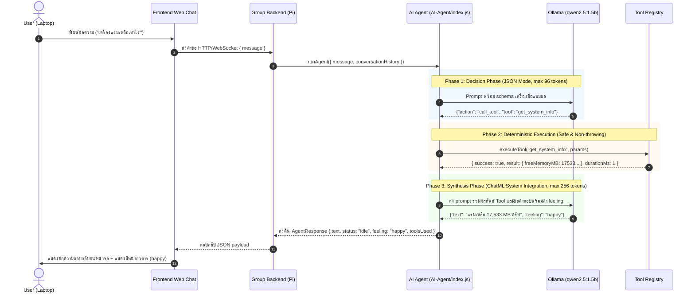

# Project Context & AI Agent Master Specification
Project Name: Local-AI-Agent (Max Headbox Adaptation)
Role: AI Agent Developer (Computer Science Group Project)
Target Hardware: Raspberry Pi 5 (4GB RAM) with Local Ollama Runtime
Client Display: Laptop (Web Chat UI and Animated Avatar)
Version: 1.1.0 (Edge Architecture Blueprint)

---

## 1. Project Background and Vision

โปรเจกต์นี้เป็นการปรับปรุงและต่อยอดจากแนวคิดของโครงการโอเพนซอร์ส Max Headbox (https://github.com/syxanash/maxheadbox) โดยดัดแปลงให้ทำงานเป็นระบบ Local AI Assistant แบบกระจายศูนย์ (Distributed System) ภายในงบประมาณฮาร์ดแวร์จำกัด

### เป้าหมายหลักของระบบ:
1. 100% Local Inference: การประมวลผลของโมเดลภาษา (LLM) ทั้งหมดเกิดขึ้นบนบอร์ด Raspberry Pi 5 ผ่าน Ollama ในเครื่อง โดยไม่ต้องพึ่งพาคลาวด์หรือเสียค่าใช้จ่ายผ่าน API ภายนอก
2. Distributed Architecture: Raspberry Pi 5 ทำหน้าที่เป็นเซิร์ฟเวอร์ประมวลผลหลัก (Headless AI Server) ในขณะที่เครื่องแล็ปท็อปของนักศึกษาเชื่อมต่อผ่านเครือข่ายภายใน (LAN) เพื่อแสดงผลหน้าเว็บแชตและใบหน้าอวตาร (Animated Avatar) ทำให้ไม่จำเป็นต้องต่อหน้าจอแยกเข้ากับบอร์ด Pi
3. Agentic Capabilities: ตัวระบบไม่ได้ทำเพียงแค่สร้างข้อความตอบกลับ แต่มีความสามารถในการคิด ตัดสินใจ และเลือกใช้เครื่องมือที่กำหนดไว้ (Deterministic Tools) ผ่าน ReAct Loop เช่น การอ่านค่าแรม ซีพียู หรือเวลาปัจจุบันของระบบ

---

## 2. Architectural Deviation from Original Max Headbox

จากการวิเคราะห์โครงสร้างเดิมของ syxanash/maxheadbox พบข้อจำกัดสำคัญที่ต้องปรับเปลี่ยนโครงสร้าง:

- สถาปัตยกรรมเดิมของ Max Headbox: รันลูปของ AI Agent, การประมวลผล Prompt, และการเรียกใช้ Tool อยู่บน Browser ฝั่ง Client (React/Vite) โดยใช้ไลบรารี ollama/browser ส่วนฝั่ง Backend (Express + Python) มีหน้าที่เพียงตรวจจับ Wake-word และบันทึกเสียงไมโครโฟน
- สถาปัตยกรรมใหม่ที่เราออกแบบ: การเปิดเว็บเบราว์เซอร์บน Raspberry Pi 5 ที่มีแรมเพียง 4GB เพื่อรัน Agent จะทำให้หน่วยความจำไม่เพียงพอและเกิดอาการค้าง ดังนั้นเราจึงแยกส่วน AI Agent ออกมาเป็น Headless Node.js Deep Module ทำงานบน Raspberry Pi 5 โดยตรง และเปิดเผย Interface ที่เรียบง่าย (runAgent) ให้ฝั่ง Backend เรียกใช้งาน

```text
┌────────────────────────────────────────────────────────────────────────┐
│                   DISTRIBUTED SYSTEM ARCHITECTURE                      │
├────────────────────────────────────────────────────────────────────────┤
│                                                                        │
│  [ LAPTOP (Student Client) ]                                          │
│  ┌──────────────────────────────────────────────────────────────────┐  │
│  │ • Web Chat UI (Frontend/index.html, style.css, app.js)           │  │
│  │ • Animated Avatar (Facial expressions driven by "feeling")       │  │
│  └──────────────────────────────────────────────────────────────────┘  │
│                                  ▲                                      │
│                                  │ HTTP / WebSocket (JSON payloads)     │
│                                  ▼                                      │
│  [ RASPBERRY PI 5 (4GB RAM) (Server) ]                                 │
│  ┌──────────────────────────────────────────────────────────────────┐  │
│  │  1. Group Backend API (Express.js / Node.js)                     │  │
│  │     └── Calls: runAgent({ message, conversationHistory })        │  │
│  │                                                                  │  │
│  │  2. AI Agent Deep Module (AI-Agent/)                             │  │
│  │     ├── Pipeline Controller (agent.js: recall -> resolve -> route)│  │
│  │     ├── Conversational Query Resolver (resolver.js: multi-turn)   │  │
│  │     ├── Deterministic Intent Router (router.js: 100% fast path)   │  │
│  │     ├── Answer Composer (answer.js: zero-token structured tools) │  │
│  │     ├── Safety & Polarity Guard (safety.js: danger/poison check) │  │
│  │     ├── Thai Query Normalizer (normalizer.js: SOV, abbreviations)│  │
│  │     ├── In-Memory Ledger (memory.js: 0 MicroSD writes)           │  │
│  │     ├── Tool Registry (registry.js: 9 deterministic tools)       │  │
│  │     ├── Dynamic Model Manager (modelManager.js: sequential unload)│  │
│  │     └── Streamed Ollama Client with FIFO Request Queue           │  │
│  │                                                                  │  │
│  │  3. Local LLM Runtime (Ollama Daemon)                            │  │
│  │     └── Models: qwen2.5:1.5b (Lite) / qwen2.5:3b (Advanced)      │  │
│  └──────────────────────────────────────────────────────────────────┘  │
└────────────────────────────────────────────────────────────────────────┘
```

---

## 3. Team Division of Labor and Seams

เพื่อป้องกันไม่ให้การทำงานของสมาชิกในกลุ่มทับซ้อนกัน ขอบเขตความรับผิดชอบและรอยต่อของโค้ด (Seam) ถูกแบ่งอย่างชัดเจน:

### 3.1 ความรับผิดชอบฝั่ง AI Agent Developer:
- พัฒนาและดูแลแกนประมวลผลของ Agent ในโฟลเดอร์ AI-Agent/
- พัฒนาระบบตัดสินใจ ReAct, การสื่อสารกับ Ollama, และการตรวจรับผลลัพธ์ที่ไม่น่าเชื่อถือ (Untrusted Output Principle)
- สร้างและทดสอบ Tool ฝั่ง Deterministic (AI-Agent/tools/)
- ควบคุมปริมาณ Token และการจัดสรรหน่วยความจำให้อยู่ในงบประมาณของแรม 4GB
- ส่งออกฟังก์ชันหลักเพียงจุดเดียว: runAgent(request) ที่คืนค่าตามสัญญาข้อมูลเสมอ
- จัดเตรียมชุดทดสอบระดับ Unit และ Integration (npm test / node --test) ให้พร้อมก่อนส่งมอบงาน

### 3.2 ความรับผิดชอบฝั่ง Backend Developer:
- พัฒนาส่วนเชื่อมต่อเครือข่ายของเซิร์ฟเวอร์บน Pi (เช่น Express.js)
- นำเข้าฟังก์ชัน runAgent จากโมดูล AI-Agent/ และส่งต่อข้อความจากเว็บแชตเข้ามาประมวลผล
- ส่งโครงสร้างข้อมูล AgentResponse กลับไปยังเครื่องแล็ปท็อปผ่าน HTTP หรือ WebSocket

### 3.3 ความรับผิดชอบฝั่ง Frontend Developer:
- ดูแลโฟลเดอร์ Frontend/ บนเครื่องแล็ปท็อป
- พัฒนาส่วนแสดงผล Web Chat UI และระบบควบคุมแอนิเมชันใบหน้าอวตาร
- แมปค่า feeling (happy, neutral, surprised, confused, proud) เข้ากับท่าทางและการแสดงอารมณ์ของอวตาร
- แสดงสถานะการทำงานของ Agent (idle, using_tool, error) บนหน้าจอ

---

## 4. Hardware Constraints and Edge Runtime Settings (Pi 5 4GB)

การรันโมเดลภาษาบนอุปกรณ์เอดจ์ต้องควบคุมพารามิเตอร์ของระบบอย่างเข้มงวดตามแนวทางใน docs/OLLAMA_AGENT_SKILL.md และ docs/TOKEN_OPTIMIZATION_GUIDE.md:

| Parameter | Limit / Policy | Engineering Rationale |
| :--- | :--- | :--- |
| Max Process RAM | ไม่เกิน 2.2 GB (Model + Node.js) | เหลือแรมอย่างน้อย 1.8 GB ให้ระบบปฏิบัติการ ป้องกันการโดน Linux OOM Killer ปิดโปรเซส |
| Context Window (num_ctx) | 1536 tokens | ป้องกัน KV Cache จองแรมเกินจำเป็น และรักษาความเร็ว prefill ให้อยู่ในช่วง 1.0 - 1.5 วินาที |
| CPU Threads (num_thread) | 3 threads | Pi 5 มี 4 คอร์ การใช้ 3 คอร์รันโมเดลช่วยเหลือ 1 คอร์ให้ Node.js Event Loop และงานเครือข่าย |
| Model & Quantization | qwen2.5:1.5b (Lite, 986 MB) / qwen2.5:3b (Adv, 1.9 GB) | สลับโมเดลแบบไดนามิก ปล่อยโมเดลเก่าด้วย keep_alive: 0 และเช็ก ps() ก่อนโหลดใหม่ ไม่ให้เกิน 2.4 GB |
| Keep-Alive (keep_alive) | 2m (2 นาที) | หลีกเลี่ยง Cold Start ในการคุยต่อเนื่อง และคืนแรม 1.3 GB อัตโนมัติเมื่อไม่มีการใช้งาน |
| Sliding Window | 4 ข้อความล่าสุด (2 turns) | กรองเฉพาะ role user และ assistant ตัดข้อความเก่าทิ้งเพื่อคุมขนาด prompt ไม่ให้บวม |
| Decision Token Limit | 96 tokens | จำกัดคำตอบในรอบตัดสินใจให้ออกมาเฉพาะ JSON สั้นๆ เพื่อประหยัดเวลาและ token |
| Synthesis Token Limit | 256 tokens | จำกัดความยาวคำตอบสรุปให้กระชับ ไม่สร้างข้อความเวิ่นเว้อ |
| Circuit Breaker | MAX_LOOP_GUARD = 3 | ป้องกันการวนลูปเรียก Tool ซ้ำอย่างไม่สิ้นสุด |
| Request Timeout | 25 วินาที (พร้อม stream.abort) | ยกเลิกการประมวลผลฝั่ง Ollama ทันทีเมื่อหมดเวลา ไม่ทิ้งภาระให้ซีพียูค้าง |

---

## 5. System Data Flow and Lifecycle



---

## 6. Public Interface Contract Summary

สัญญาข้อมูลฉบับเต็มถูกบันทึกไว้ใน docs/AGENT_API_CONTRACT.md

### รูปแบบการเรียกใช้งาน:
```javascript
import { runAgent } from './AI-Agent/index.js';

const response = await runAgent({
  message: "เครื่องสถานะเป็นยังไงบ้าง แรมเหลือเท่าไหร่", // จำเป็น: ข้อความจากผู้ใช้
  conversationHistory: [                              // ไม่บังคับ: ประวัติการสนทนาก่อนหน้า
    { role: "user", content: "สวัสดี" },
    { role: "assistant", content: "สวัสดีครับ" }
  ],
  options: {}                                         // ไม่บังคับ: การ override โมเดลหรือฟังก์ชัน
});
```

### โครงสร้างข้อมูลที่ส่งกลับ (AgentResponse):
```json
{
  "text": "เครื่องสถานะดีค่ะ แรมเหลือ 17,533 MB",
  "status": "idle",
  "feeling": "happy",
  "toolsUsed": [
    {
      "success": true,
      "tool": "get_system_info",
      "params": {},
      "result": {
        "platform": "win32",
        "arch": "x64",
        "cpuCores": 12,
        "totalMemoryMB": 32472,
        "freeMemoryMB": 17533,
        "usedMemoryMB": 14938,
        "memoryUsagePercent": 46.0,
        "uptimeHours": 116.1
      },
      "durationMs": 1
    }
  ],
  "error": null
}
```

---

## 7. Project Codebase Architecture

```text
Local-AI-Agent/
├── docs/
│   ├── PROJECT_CONTEXT.md          # [เอกสารนี้] แหล่งอ้างอิงภาพรวมสถาปัตยกรรมระบบ
│   ├── AGENT_API_CONTRACT.md       # สัญญาข้อต่อข้อมูลระหว่าง Agent, Backend และ Frontend
│   ├── PI_RUNBOOK.md               # คู่มือการตั้งค่า ZRAM และ Systemd สำหรับ Raspberry Pi 5
│   ├── AGENT_RULES.md              # กฎเหล็กเชิงวิศวกรรม (Zero Emojis, Restrained Typography)
│   ├── OLLAMA_AGENT_SKILL.md       # พิมพ์เขียวเชิงวิศวกรรมสำหรับ Small LLM และ Edge AI
│   └── TOKEN_OPTIMIZATION_GUIDE.md # คู่มือและกลยุทธ์การบริหารจัดการ Token
├── AI-Agent/
│   ├── index.js                    # Entry point หลัก (Deep Module seam ส่งออก runAgent)
│   ├── agent.js                    # ReAct controller, faithful synthesis, prompt templates
│   ├── router.js                   # 2-Stage Intent Router คัดแยกประเภทคำถามด้วย Deterministic Rules
│   ├── normalizer.js               # Thai Query Normalizer ถอดคำย่อ, ขยายคีย์เวิร์ด, SOV Disambiguation
│   ├── memory.js                   # In-memory Session Memory & Note Memory Ledger (0 disk writes)
│   ├── culture.js                  # มุกตลก คำศัพท์วัยรุ่น และ Roleplay Persona Adapter
│   ├── queue.js                    # FIFO RequestQueue ป้องกัน Raspberry Pi 5 แรมเต็ม (OOM)
│   ├── server.js                   # Express server รองรับ /api/chat และ /api/chat/stream (SSE)
│   ├── ollamaClient.js             # Streamed Ollama client พร้อม abort controller และ Pi options
│   ├── parse.js                    # ตัวสกัด JSON, ตรวจสอบ feeling, และล้างประวัติแชต
│   ├── cli.js                      # สคริปต์ทดสอบผ่าน Terminal
│   ├── README.md                   # คู่มือประจำโมเดล AI Agent สำหรับสมาชิกในกลุ่ม
│   └── tools/
│       ├── registry.js             # ระบบลงทะเบียน Tool, ตรวจชนิดพารามิเตอร์ และคุม Timeout (5s)
│       ├── systemInfo.js           # เครื่องมืออ่านสถานะแรม ซีพียู และระบบ (get_system_info)
│       ├── time.js                 # เครื่องมืออ่านเวลาและวันที่ปัจจุบัน (get_current_time)
│       ├── calculator.js           # เครื่องมือคำนวณคณิตศาสตร์ปลอดภัย (calculate)
│       ├── github.js               # เครื่องมือค้นหาคลังโค้ดและผู้ใช้ GitHub (search_github)
│       ├── wiki.js                 # ค้นหา Wikipedia พร้อม Deep Passage Retrieval (search_wikipedia)
│       ├── webSearch.js            # ค้นหาเว็บเปิด Zero-Key (DuckDuckGo Lite & Wikipedia Snippet) (search_web)
│       ├── news.js                 # เครื่องมือดึงข่าวสารล่าสุดจาก Google News RSS (get_news)
│       ├── feedParser.js           # ตัวแยกส่วน XML/RSS Feed
│       ├── weather.js              # ตรวจสอบสภาพอากาศ Open-Meteo Real-time (get_weather)
│       └── fx.js                   # คำนวณอัตราแลกเปลี่ยนเงินตราสากล (get_fx)
├── Frontend/                       # โฟลเดอร์หน้าเว็บและแอนิเมชันของสมาชิกฝั่ง Frontend
│   ├── index.html                  # หน้าจอแชตและแสดงผลอวตาร (CRT Cyberpunk Terminal)
│   ├── style.css                   # สไตล์ชีท
│   ├── app.js                      # โค้ดควบคุมหน้าบ้าน รองรับ SSE Token Streaming
│   └── ReadMe.md                   # เอกสารประกอบของ Frontend
├── .agents/                        # โฟลเดอร์เก็บ Engineering Skills สำหรับ AI Pair Programming
│   └── skills/                     # codebase-design, code-review, git-guardrails-claude-code ฯลฯ
├── tests/                          # ชุดการทดสอบระบบ (226 tests, 59 suites ผ่าน 100%)
│   ├── *.test.js                   # ชุดทดสอบ Unit & Integration ครบทุกโมดูล
│   └── eval/                       # ชุดทดสอบ Benchmark ประเมิน Router Accuracy และ 10-turn Recall
├── package.json                    # กำหนดคุณสมบัติโปรเจกต์ ES Module ("type": "module")
├── .gitignore                      # ละเว้น node_modules, tests, logs, .env
└── README.md                       # หน้าหลักของคลังโค้ด
```

---

## 8. Standards for Creating New Tools

หากต้องการเพิ่ม Tool ใหม่เข้าระบบ ให้ปฏิบัติตามแนวทาง Test-Driven Development (TDD):
1. สร้างไฟล์เครื่องมือใน AI-Agent/tools/<toolName>.js
2. กำหนดโครงสร้าง Tool:
   - name: ชื่อฟังก์ชันรูปแบบ snake_case (เช่น read_dht22)
   - description: คำอธิบายสั้นและตรงประเด็น (ระบุชัดเจนว่าเครื่องมือนี้ส่งค่าอะไรกลับมา)
   - parameters: โครงสร้าง JSON Schema ระดับบนสุดแบบเรียบง่าย (Primitive types เท่านั้น)
   - dangerous: ค่าบูลีน (กำหนดเป็น true หากต้องการการยืนยันก่อนทำงาน)
   - execute(params): ฟังก์ชัน async ที่คืนค่าผลลัพธ์เป็น Object
3. ลงทะเบียน Tool ใน AI-Agent/tools/registry.js
4. เขียน Unit Test ใน tests/tools.test.js เพื่อทดสอบค่าที่คืนมาและการปฏิเสธพารามิเตอร์ผิดประเภท
5. รัน node --test tests/*.test.js เพื่อยืนยันว่าการทดสอบผ่านครบ 100%

---

## 9. Verification and CLI Usage

### การรันชุดทดสอบอัตโนมัติทั้งหมด:
```bash
node --test tests/*.test.js
```
รันการทดสอบทั้งหมด 226 ข้อ (59 suites) ครอบคลุมทั้งตรรกะ ReAct ออฟไลน์, การสกัด JSON, กลไก Timeout/Abort, ความปลอดภัยของพารามิเตอร์, Intent Router, Thai Query Normalizer, Active/Passive SOV Analysis, Note Memory Ledger, Zero-Key Web Search, และ All-Ages Conversational Intelligence

### การรัน Benchmark ประเมินความแม่นยำ:
```bash
node tests/eval/runner.js
```
ตรวจสอบ Router Accuracy (100% 69/69 queries ข้าม 18 หมวดหมู่), 10-Turn Recall Rate (100%), RSS Memory (< 42MB), และ MicroSD Card Writes (0 bytes)

### การรันทดสอบคุยกับ Agent ผ่าน Terminal:
```bash
# ทดสอบถามสถานะเครื่องและแรม (เรียกใช้ get_system_info)
node AI-Agent/cli.js "เครื่องสถานะเป็นยังไงบ้าง แรมเหลือเท่าไหร่"

# ทดสอบถามเวลาปัจจุบัน (เรียกใช้ get_current_time)
node AI-Agent/cli.js "ตอนนี้เวลาเท่าไหร่แล้ว"

# ทดสอบถามข้อมูลบุคคลหรือประวัติศาสตร์ (เรียกใช้ search_wikipedia แบบ Deep Passage)
node AI-Agent/cli.js "ไอน์สไตน์ได้รางวัลโนเบลจากเรื่องอะไร"

# ทดสอบถามข้อมูลบริโภคหรือชีวิตประจำวัน (เรียกใช้ search_web พร้อม SOV Disambiguation)
node AI-Agent/cli.js "แมวกินช็อกโกแลตได้ไหม"

# ทดสอบการคุยทั่วไปหรือมุกตลก (เรียกใช้ culture wit engine)
node AI-Agent/cli.js "เล่ามุกฮาๆ ให้ฟังหน่อย"
```

---

## 10. Git Workflow and Safety Guardrails

- นโยบาย Branch: งานพัฒนาทั้งหมดจะถูกพัฒนาและทดสอบจนสมบูรณ์บน branch AI-Agent ก่อนทำการ Fast-Forward รวมเข้าสู่ main
- ข้อควรระวังด้านความปลอดภัย:
  - ห้าม commit ไฟล์น้ำหนักโมเดล (.bin, .gguf, blobs) ขึ้น Git โดยเด็ดขาด
  - ห้าม commit ไฟล์ .env หรือกุญแจสำคัญ
  - ห้ามใช้คำสั่ง git push --force หรือทำ destructive rebase บน branch ที่ใช้งานร่วมกัน
- เงื่อนไขก่อนส่งมอบงาน (Handoff Checklist):
  1. การรัน node --test tests/*.test.js ผ่านครบ 100% (226/226 tests)
  2. การรัน node tests/eval/runner.js ผ่านครบ 100% (69/69 queries, 10-turn recall 100%)
  3. เอกสารทางเทคนิคใน docs/, AI-Agent/README.md และ README.md หลัก อัปเดตตรงตามโค้ดจริง
  4. ตรวจสอบสถานะ git status ให้สะอาดเรียบร้อย

