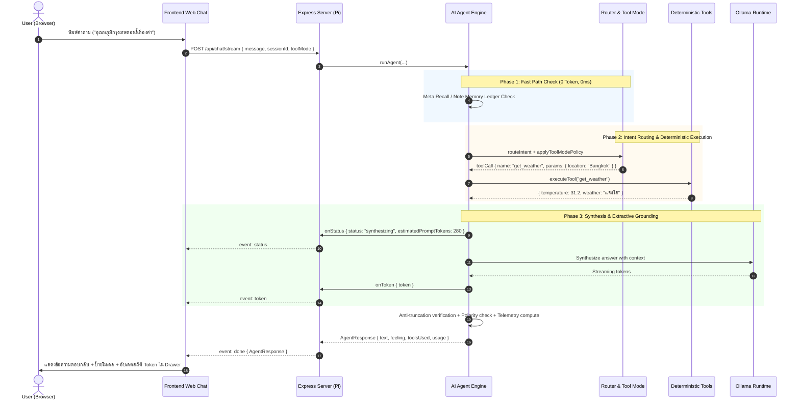

# Project Context & AI Agent Master Specification

**Project Name:** Local-AI-Agent (Max Headbox Adaptation)  
**Role:** AI Agent Developer & System Architect  
**Target Hardware:** Raspberry Pi 5 (4GB RAM) with Local Ollama Runtime  
**Client Display:** Laptop / Tablet Web Browser (Web Chat UI & Animated Avatar)  
**Version:** 2.0.0 (Adaptive RAG, Tool Modes, Telemetry & Multi-Model Architecture)  

---

## 1. Project Background & Vision

โปรเจกต์นี้เป็นการปรับปรุงและต่อยอดจากแนวคิดของโครงการโอเพนซอร์ส [Max Headbox](https://github.com/syxanash/maxheadbox) โดยดัดแปลงให้ทำงานเป็นระบบ Local AI Assistant แบบกระจายศูนย์ (Distributed System) ภายในงบประมาณฮาร์ดแวร์จำกัด

### เป้าหมายหลักของระบบ:
1. **100% Local Inference**: การประมวลผลของโมเดลภาษา (LLM) เกิดขึ้นบนบอร์ด Raspberry Pi 5 ผ่าน Ollama ในเครื่อง โดยไม่ต้องพึ่งพาคลาวด์หรือเสียค่าใช้จ่ายผ่าน API ภายนอก (ยกเว้นบริการค้นหาเว็บทางเลือก)
2. **Distributed Architecture**: Raspberry Pi 5 ทำหน้าที่เป็นเซิร์ฟเวอร์ประมวลผลหลัก (Headless Edge AI Server) ในขณะที่เครื่องแล็ปท็อปของนักศึกษาเชื่อมต่อผ่านเครือข่ายภายใน (LAN) เพื่อแสดงผลหน้าเว็บแชตและใบหน้าอวตาร (Animated Avatar) ทำให้ไม่จำเป็นต้องต่อหน้าจอแยกเข้ากับบอร์ด Pi
3. **Adaptive RAG & Deterministic Tooling**: ระบบผสมผสานการตัดสินใจแบบ 0 ms (Deterministic Router), การจำกัดการค้นหาตามโหมดเครื่องมือ (Tool Modes: Auto, Chat, Search), การสังเคราะห์คำตอบแบบไม่เปลืองโทเค็น (Answer Composer), และการสืบค้นเว็บแบบสองชั้น (Tavily AI Search / DuckDuckGo HTML Lite)

---

## 2. Architectural Deviation from Original Max Headbox

จากการวิเคราะห์โครงสร้างเดิมของ `syxanash/maxheadbox` พบข้อจำกัดสำคัญที่ต้องปรับเปลี่ยนโครงสร้าง:

- **สถาปัตยกรรมเดิมของ Max Headbox**: รันลูปของ AI Agent, การประมวลผล Prompt, และการเรียกใช้ Tool อยู่บน Browser ฝั่ง Client (React/Vite) โดยใช้ไลบรารี `ollama/browser` ส่วนฝั่ง Backend (Express + Python) มีหน้าที่เพียงตรวจจับ Wake-word และบันทึกเสียงไมโครโฟน
- **สถาปัตยกรรมใหม่ที่เราออกแบบ**: การเปิดเว็บเบราว์เซอร์บน Raspberry Pi 5 ที่มีแรมเพียง 4GB เพื่อรัน Agent จะทำให้หน่วยความจำไม่เพียงพอและเกิดอาการค้าง ดังนั้นเราจึงแยกส่วน AI Agent ออกมาเป็น Headless Node.js **Deep Module** ทำงานบน Raspberry Pi 5 โดยตรง และเปิดเผย Interface ที่เรียบง่าย (`runAgent`) ให้ฝั่ง Backend เรียกใช้งาน

```text
┌────────────────────────────────────────────────────────────────────────┐
│                   DISTRIBUTED SYSTEM ARCHITECTURE                      │
├────────────────────────────────────────────────────────────────────────┤
│                                                                        │
│  [ LAPTOP / CLIENT DEVICE ]                                            │
│  ┌──────────────────────────────────────────────────────────────────┐  │
│  │ • Web Chat UI (Frontend/index.html, style.css, app.js)           │  │
│  │ • Animated Avatar (Facial expressions driven by "feeling")       │  │
│  │ • Model Switcher (Lite 1.5B / Adv 3B)                            │  │
│  │ • Tool Mode Switcher (Auto / Chat / Search)                      │  │
│  │ • Real-Time Token & Context Telemetry Drawer                     │  │
│  └──────────────────────────────────────────────────────────────────┘  │
│                                  ▲                                      │
│                                  │ HTTP REST / Server-Sent Events (SSE) │
│                                  ▼                                      │
│  [ RASPBERRY PI 5 (4GB RAM) (Edge Server) ]                            │
│  ┌──────────────────────────────────────────────────────────────────┐  │
│  │  1. Express.js Server (Port 3000)                                │  │
│  │     ├── RequestQueue (FIFO Concurrency Guard, limit 1 concurrent)│  │
│  │     └── SSE Streaming Engine (/api/chat/stream)                  │  │
│  │                                                                  │  │
│  │  2. AI Agent Deep Module (AI-Agent/)                             │  │
│  │     ├── Pipeline Controller (agent.js)                           │  │
│  │     ├── Thai Normalizer & Resolver (normalizer.js, resolver.js)  │  │
│  │     ├── Zero-Token Meta & Note Recall (memory.js, 0ms)           │  │
│  │     ├── Deterministic Intent Router (router.js: 23 categories)   │  │
│  │     ├── Tool Mode Policy Engine (toolMode.js: auto, chat, search)│  │
│  │     ├── Deterministic Tool Suite (9 tools in tools/)             │  │
│  │     ├── Dual Search Providers (Tavily AI / DuckDuckGo Lite)      │  │
│  │     ├── Answer Composer (answer.js: 0-token structured templates)│  │
│  │     ├── Anti-Truncation & Polarity Guard (answer.js, safety.js)  │  │
│  │     ├── Real-Time Telemetry Engine (telemetry.js)                │  │
│  │     └── Dynamic Model Manager (modelManager.js: sequential unload│  │
│  │                                                                  │  │
│  │  3. Local LLM Runtime (Ollama Daemon)                            │  │
│  │     └── Models: qwen2.5:1.5b (Lite) / qwen2.5:3b (Advanced)      │  │
│  └──────────────────────────────────────────────────────────────────┘  │
└────────────────────────────────────────────────────────────────────────┘
```

---

## 3. Team Division of Labor & Seams

เพื่อป้องกันไม่ให้การทำงานของสมาชิกในกลุ่มทับซ้อนกัน ขอบเขตความรับผิดชอบและรอยต่อของโค้ด (Seam) ถูกแบ่งอย่างชัดเจน:

### 3.1 ความรับผิดชอบฝั่ง AI Agent Developer:
- พัฒนาและดูแลแกนประมวลผลของ Agent ในโฟลเดอร์ `AI-Agent/`
- พัฒนาระบบตัดสินใจ Adaptive RAG, การเชื่อมต่อ Ollama, และการตรวจรับผลลัพธ์ที่ไม่น่าเชื่อถือ (Untrusted Output Principle)
- สร้างและทดสอบ Tool ฝั่ง Deterministic (`AI-Agent/tools/`)
- ควบคุมปริมาณ Token และการจัดสรรหน่วยความจำให้อยู่ในงบประมาณของแรม 4GB
- ส่งออกฟังก์ชันหลักเพียงจุดเดียว: `runAgent(request)` ที่คืนค่าตามสัญญาข้อมูลเสมอ
- จัดเตรียมชุดทดสอบระดับ Unit และ Integration (`npm test` / `node --test`) ให้พร้อมก่อนส่งมอบงาน

### 3.2 ความรับผิดชอบฝั่ง Backend Developer:
- พัฒนาส่วนเชื่อมต่อเครือข่ายของเซิร์ฟเวอร์บน Pi (`server.js`, Express.js)
- นำเข้าฟังก์ชัน `runAgent` จากโมดูล `AI-Agent/` และส่งต่อข้อความจากเว็บแชตเข้ามาประมวลผล
- ให้บริการ REST และ Server-Sent Events (SSE) Streaming แก่หน้าเว็บ

### 3.3 ความรับผิดชอบฝั่ง Frontend Developer:
- ดูแลโฟลเดอร์ `Frontend/`
- พัฒนาส่วนแสดงผล Web Chat UI, ระบบควบคุมแอนิเมชันใบหน้าอวตาร (`feeling`), และ Telemetry Drawer
- แมปค่า `feeling` (`happy`, `neutral`, `surprised`, `confused`, `proud`) เข้ากับท่าทางและการแสดงอารมณ์ของอวตาร

---

## 4. Hardware Constraints and Edge Runtime Settings (Pi 5 4GB)

| Parameter | Limit / Policy | Engineering Rationale |
| :--- | :--- | :--- |
| **Max Process RAM** | ไม่เกิน 2.8 GB (Model + Node.js) | เหลือแรมอย่างน้อย 1.2 GB ให้ระบบปฏิบัติการ ป้องกันการโดน Linux OOM Killer ปิดโปรเซส |
| **Context Window (`numCtx`)** | 4,096 tokens | ขยายพื้นที่บริบทให้เพียงพอสำหรับอ่านเนื้อหาเว็บและเอกสารวิจัยยาวๆ โดยไม่กินแรมเกินขนาด |
| **CPU Threads (`num_thread`)** | 3 threads | Pi 5 มี 4 คอร์ การใช้ 3 คอร์รันโมเดลช่วยเหลือ 1 คอร์ให้ Node.js Event Loop และงานเครือข่าย |
| **Model Selection** | `qwen2.5:1.5b` (Lite) / `qwen2.5:3b` (Adv) | สลับโมเดลแบบไดนามิก ปล่อยโมเดลเก่าด้วย `keep_alive: 0` และเช็ก `ps()` ก่อนโหลดใหม่ |
| **Keep-Alive (`keep_alive`)** | 2m (2 นาที) | หลีกเลี่ยง Cold Start ในการคุยต่อเนื่อง และคืนแรม 1.2 - 2.4 GB อัตโนมัติเมื่อไม่มีการใช้งาน |
| **Sliding Window** | 10 ข้อความล่าสุด (1,200 chars) | กรองเฉพาะ role user และ assistant ตัดข้อความเก่าทิ้งเพื่อคุมขนาด prompt ไม่ให้บวม |
| **Generation Limit (`numPredict`)** | 600 tokens (Lite) / 768 tokens (Adv) | ขยายโควตาการคิดสังเคราะห์คำตอบ ไม่ตัดทอนประโยคกลางคัน |
| **Circuit Breakers** | MAX_LOOP_GUARD = 3 | ป้องกันการวนลูปเรียก Tool ซ้ำอย่างไม่สิ้นสุด |
| **Request Timeout** | 45 วินาที (Stall) / 180 วินาที (Max Synthesis) | ป้องกันค้างและมี AbortController ตัดการเชื่อมต่อทันที |

---

## 5. System Data Flow and Lifecycle



---

## 6. Project Codebase Architecture

```text
Local-AI-Agent/
├── docs/                               # แหล่งอ้างอิงและพิมพ์เขียวเชิงสถาปัตยกรรม
│   ├── PROJECT_CONTEXT.md              # [เอกสารนี้] พิมพ์เขียวสถาปัตยกรรมระบบฉบับหลัก
│   ├── AGENT_API_CONTRACT.md           # สัญญาข้อต่อข้อมูลระหว่าง Agent, Backend และ Frontend
│   ├── PI_RUNBOOK.md                   # คู่มือการตั้งค่า ZRAM และ Systemd สำหรับ Raspberry Pi 5
│   ├── AGENT_RULES.md                  # กฎเหล็กเชิงวิศวกรรม (Zero Emojis, Restrained Typography)
│   ├── OLLAMA_AGENT_SKILL.md           # พิมพ์เขียวเชิงวิศวกรรมสำหรับ Small LLM และ Edge AI
│   └── TOKEN_OPTIMIZATION_GUIDE.md     # คู่มือและกลยุทธ์การบริหารจัดการ Token
├── AI-Agent/                           # แกนประมวลผลหลัก (Deep Module)
│   ├── index.js                        # Entry point หลัก (runAgent, applyToolModePolicy)
│   ├── agent.js                        # Pipeline controller (Recall -> Resolve -> Route -> Synthesize)
│   ├── telemetry.js                    # Telemetry engine คำนวณ Token และ Context Window Real-time
│   ├── toolMode.js                     # ระบบควบคุมโหมดเครื่องมือ (auto, chat, search)
│   ├── modelManager.js                 # ระบบสลับโมเดลไดนามิก ปลอดภัยด้วย Sequential Unload
│   ├── router.js                       # 100% Deterministic Router (23 หมวดหมู่)
│   ├── resolver.js                     # Conversational Query Resolver เชื่อมประธานคำถามต่อเนื่อง
│   ├── answer.js                       # Answer Composer (0-token templates) และ Anti-Truncation ภาษาไทย
│   ├── safety.js                       # Polarity & Danger/Toxicity Guard
│   ├── normalizer.js                   # Thai Query Normalizer, Slang, และ Active/Passive SOV
│   ├── memory.js                       # Session Memory (10 รอบ) และ Note Memory Ledger ใน RAM
│   ├── culture.js                      # มุกตลก คำศัพท์วัยรุ่น และ Roleplay Persona Adapter
│   ├── queue.js                        # FIFO RequestQueue ป้องกันแรมล้น (OOM)
│   ├── server.js                       # Express Server รองรับ REST และ SSE Streaming
│   ├── ollamaClient.js                 # Streamed Ollama client (numCtx 4096, keep_alive 2m)
│   ├── parse.js                        # ตัวสกัด JSON ปลอดภัย และ Sliding History Sanitizer
│   ├── cli.js                          # สคริปต์ทดสอบผ่าน Terminal
│   ├── README.md                       # คู่มือประจำโมดูล AI Agent
│   └── tools/                          # โฟลเดอร์เครื่องมือ Deterministic Tools
│       ├── registry.js                 # Tool Registry ตรวจสอบพารามิเตอร์และคุม Timeout
│       ├── systemInfo.js               # get_system_info
│       ├── time.js                     # get_current_time
│       ├── calculator.js               # calculate
│       ├── weather.js                  # get_weather
│       ├── fx.js                       # get_fx
│       ├── news.js                     # get_news
│       ├── feedParser.js               # ตัวแปลง RSS/XML Feed
│       ├── github.js                   # search_github
│       ├── wiki.js                     # search_wikipedia พร้อม Deep Passage Extraction
│       ├── webSearch.js                # search_web แบบ Single Facade
│       └── search/                     # ผู้ให้บริการสืบค้นเว็บ
│           ├── tavily.js               # Tavily Search Provider
│           └── duckduckgo.js           # DuckDuckGo HTML Lite Provider (Zero-Key)
├── Frontend/                           # ส่วนติดต่อผู้ใช้และแอนิเมชันอวตาร
│   ├── index.html                      # หน้าจอแชตและแผงควบคุมสถิติ Token
│   ├── style.css                       # สไตล์ชีท Cyber-Minimalist รองรับมือถือ
│   ├── app.js                          # โค้ดควบคุมหน้าบ้าน รองรับ SSE Streaming และ Real-time Meters
│   └── ReadMe.md                       # เอกสารประกอบของ Frontend
├── .agents/skills/                     # Local AI Developer Skills
├── tests/                              # ชุดทดสอบระบบ (290 tests, 71 suites ผ่าน 100%)
│   ├── *.test.js                       # ชุดทดสอบ Unit & Integration ครบทุกโมดูล
│   └── eval/                           # ชุดทดสอบ Benchmark ประเมิน Router Accuracy, Memory, Tool Modes
├── package.json                        # Node.js ES Modules Manifest
├── .gitignore                          # ระเบียบความสะอาดของคลังโค้ด
└── README.md                           # หน้าหลักของคลังโค้ดบน GitHub
```

---

## 7. Verification & Benchmarking Standards

- การรันชุดทดสอบอัตโนมัติทั้งหมด:
  ```bash
  npm test
  ```
  ผ่านการทดสอบ 290 ข้อ (71 suites) ครอบคลุมทั้ง ReAct Pipeline, Intent Routing, Thai Query Normalizer, Note Memory Ledger, Zero-Key Web Search, Dynamic Model Switching, Tool Modes, และ Token Telemetry Engine
- การรันชุดประเมิน Benchmark คุณภาพ:
  ```bash
  node tests/eval/runner.js
  ```
  ตรวจสอบความแม่นยำของ Intent Router (100% 86/86 queries), 10-Turn Memory Recall (100% 27/27 turns), Tool Mode Policy (100% 16/16 checks), Truncation Defects (0 รายการ), และ MicroSD Card Writes (0 bytes)
